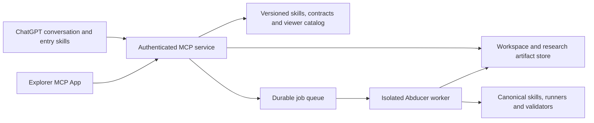

# Abducer ChatGPT plugin packaging plan

Plan dated 2026-10-25, based on repository commit `9dbacf63`. This document records the design for a public hosted Abducer service with named user accounts, a ChatGPT Explorer interface, and reusable research skills. The subsequent implementation lives in `integrations/chatgpt/` and `plugins/abducer-chatgpt/`; see [the operator guide](../integrations/chatgpt-plugin.md). Local transport, worker-boundary and browser tests now exist. A production endpoint, external login integration and live scientific model execution still require operator configuration and separate verification.

The central decision is to retain one canonical skill library and research runtime, then generate the client packages and add a small hosted integration layer. Explorer and conversation must inspect the same versioned research objects. An installation should let a user connect their account, explore work, plan an investigation, run a bounded cycle, and inspect its evidence.

The user selected public hosting with named users. Initial access is assumed to be provisioned/invited accounts; public self-registration and billing can follow. A publicly reachable endpoint does not make research data public. “Explorer” is interpreted as this repository's workflow, discovery-graph, and report views; the separate Lunar/prism-viewer frontend source must be located before promising direct component reuse.

## Existing foundations and their reuse

| Foundation | Verified source | Reuse and remaining work |
| --- | --- | --- |
| 221 public canonical skills | `skills/*/*/SKILL.md`, `plugins/abducer/source-skills.json` | Preserve instructions, ownership and claim gates; classify support dependencies and hosted readiness per skill. |
| Generated plugin entries | `integrations/agent_plugins/generate.py`, `plugins/abducer/` | Extend the generator with a hosted profile. Existing wrappers resolve a local writable checkout and cannot simply be shipped unchanged for remote execution. |
| 34 normalized workflow contracts | `plugins/abducer/workflows.json`, `agentic/reasoning_flows/workflow_skill_v1/` | Reuse identities, contracts, owner references and digests. Contract visibility is distinct from executable support. |
| Read-only MCP catalog and asset snapshot | `integrations/workflow_mcp/server.py`, `integrations/workflow_mcp/agent_assets.py` | Reuse catalog logic, bounded asset reads, source closure and digest validation behind Streamable HTTP. Preserve the existing stdio client. |
| 19 typed viewer workflows | `integrations/domain_package/assets/bundle.json`, `viewer.py`, `build_viewer.py` | Reuse source-bound graphs, examples, materialization metadata and validation. These 19 views and 34 contracts are different inventories; map them explicitly. |
| Discovery graph | `skills/orchestration/kb-orchestrator/scripts/generate_discovery_graph_explorer.py` | Reuse stage semantics, graph extraction and report data; adapt rendering to the host bridge. |
| Reports and export | `integrations/domain_package/export.py`, `exporter.py`, `verify.py` | Reuse deterministic snapshots, manifests, provenance and selected support trees. Audit the closure for a production package rather than uploading every historical artifact. |
| Bounded native research adapter | `integrations/domain_package/marathon_runtime.py`, `runtime_registration.py` | Reuse prepare/execute/verify and the canonical runner. Replace Lunar-specific model/service wiring with a hosted adapter. Multi-invocation continuation needs new durable state management. |

The current Python wheel includes selected `agentic` packages, not all skill scripts, schemas, KBs, or viewer assets. A wheel alone is not the hosted research installation. Initially build an immutable worker image with the declared repository support closure and locked dependencies. Refactor package boundaries only when that materially reduces maintenance.

## Product and deployment shape

Ship one user-facing Abducer plugin. Its logical deployment units are a generated skill package, a Python MCP/API service, an Explorer UI bundle, isolated research workers, a job/state database, and an artifact store. These do not need six separate repositories or independently published Python packages.

Keep three execution boundaries explicit:

1. ChatGPT performs conversation, clarification, planning and explanation using the entry skills and retrieved source instructions.
2. The service provides authorized catalog/result reads and job lifecycle operations.
3. Workers run canonical scientific workflows, tools, validators and state transitions. A conversational proposal is not a committed research result.

The worker requires its own configured model provider and budget. Do not assume that a user's ChatGPT subscription supplies backend model calls or that a remote MCP server can reuse Lunar's host completion channel. Preserve the existing prompt/schema/model-request contract through an explicit provider adapter.

## Skill reuse strategy

Keep canonical `skills/**/SKILL.md` as the only research-procedure source. Extend the existing generator instead of maintaining another hand-written catalog. Preserve the current full local plugin profile; add a hosted profile with concise client routing and release-pinned server execution.

Generate a capability ledger for every public skill and workflow with: canonical identity/path/digest, dependency closure, input/output schemas, prerequisites, execution mode, side effects, model/network requirements, hosted support status, and evidence/test links. Use explicit statuses such as `inspectable`, `chat-assisted`, `hosted-executable`, and `blocked-prerequisite`. A skill enters the executable allowlist only after its adapter and acceptance tests pass.

Suggested ChatGPT entry layer:

| Proposed entry skill | Existing skills and assets it routes to |
| --- | --- |
| `abducer-setup` | Account/workspace selection, capability readiness and existing setup guidance. This is new integration behavior. |
| `abducer-explore` | `kb-orchestrator`, `result-atlas-maintainer`, typed viewer bundle, graph/report readers. |
| `abducer-plan` | `orch`, `kb-orchestrator`, workflow contracts and their prerequisites. Produces a reviewable bounded research plan. |
| `abducer-research` | `work`, `kb-discovery-cycle`, `kb-abduce`, `kb-deduce`, `parallel-hypothesis-portfolio`, `reflective-theory-synthesizer`, `kb-hypothesis-evaluator`, as admitted by the selected workflow. |
| `abducer-report` | Existing report generators, result atlas and evidence/status readers. Explains recorded outcomes without promoting claims. |

These five skills coordinate access; they do not replace 221 skills with five rewritten prompts. Preserve specialist procedures behind existing orchestration. Domain-specific and private skill activation stays explicit. Non-executable skills remain useful for inspection and planning.

OpenAI's current MCP skill-import path accepts five named skills and imports a static submission-time snapshot. Treat that limit as specific to that import path, not a universal five-skill plugin limit. The proposed five entry skills fit it; the backend retains the full canonical library. Discovering additional source instructions through a tool is ordinary content retrieval, not dynamic installation of hundreds of new skills. Re-scan and version the published package when imported entry skills change. [MCP skill import](https://developers.openai.com/plugins/build/mcp-server)

For a genuinely portable instruction-only skill, generate a source-bound client bundle with its required references. For a script-backed skill, execute in the worker and return typed artifacts. For unavailable dependencies, return a precise readiness reason. Avoid copying the entire research checkout into the ChatGPT skill import.

## Explorer experience

Reuse the graph/report models and existing renderer components wherever their source and license can be established. `build_viewer.py` currently requires an explicit external `prism-viewer` checkout for regeneration; the committed bundle is reusable immediately, but this checkout is not proof that all frontend components are present here.

The initial interface has four views: workflow catalog and typed graph; project/run timeline; hypothesis/evidence detail; and report viewer. Clicking a node should give ChatGPT a bounded reference containing project, workflow/run, object ID and snapshot version. Keep full graph and report payloads out of routine model context. Preserve hypothesis, proof sketch, validated artifact and scientific truth as different statuses.

Implement the UI as an MCP App using `_meta.ui.resourceUri` and the standard `ui/*` bridge. Separate data tools from `open_explorer`, so ordinary reads do not repeatedly remount the UI. Keep text and structured results sufficient when no UI is available. [ChatGPT UI guidance](https://developers.openai.com/plugins/build/chatgpt-ui)

After the basic flow works, expose Explorer as a global sidebar entry and conversation side panel. Add deep links to exact runs and nodes. A `.prism` file viewer is a later enhancement, after untrusted-file handling and source mapping are tested. These richer entrypoints are extensions, so test availability in the target clients and retain the ordinary render-tool path. [Plugin extensions](https://developers.openai.com/plugins/build/extensions)

Do not assume existing generated HTML works unchanged in the ChatGPT iframe. Audit asset loading, MathJax, navigation, event handling and content security policy. Use a structured viewer where practical; preserve original reports as authorized downloads or tested sandboxed views.

## Proposed tool contract

Names below are proposed except the existing catalog and asset tools. Keep catalog discovery compact; do not expose one MCP tool per research skill.

| Tool family | Proposed contract and behavior |
| --- | --- |
| Account | `get_profile`, `list_projects`: identity and permitted workspaces from validated credentials. |
| Catalog | Retain `list_workflows`, `get_workflow`; add `search_skills`, `get_skill`, `get_capabilities` with version and readiness. Restrict asset reads to an approved release closure. |
| Evidence | `search_research`, `get_research_object`, `get_report`: bounded, paginated results with IDs, scope, source links, digest and snapshot version. |
| Presentation | `open_explorer`: validated project/run/workflow/object selection and a versioned UI resource. |
| Planning | `prepare_research_run`: validates target, workflow, inputs, current state, budget and capabilities; persists a plan ID and expiry without starting model work. Mark as a write if it persists. |
| Execution | `start_research_run(plan_id, idempotency_key)`: rechecks authorization and currentness, queues one approved bounded job, returns a job ID promptly. |
| Lifecycle | `get_run_status`, `list_run_artifacts`, `cancel_run`: durable status and verified outputs; cancellation has explicit terminal semantics. |

Bind a plan to account, project, source release, workflow, input hashes, target/run state version, resource budget and permitted network/model actions. Reject stale plans on start. Store the idempotency key and enqueue transactionally to prevent duplicate model spending on retries.

Use an explicit job state machine: queued → running → succeeded/failed/cancelled, with cancellation requested represented separately while a worker drains. Persist checkpoints and terminal receipts. Continuation starts from a verified committed parent with optimistic concurrency/single-writer protection; a new chat or worker restart must not reset to the original export snapshot. Publish artifacts atomically after verification and preserve diagnostics for failures.

## Named users and hosting

Use OAuth account linking and derive a stable subject from validated credentials. Map that subject to Abducer users and project memberships on the server; never trust a tool-supplied user name or email as authority. Start with viewer, researcher and administrator roles. Apply project authorization to every catalog item that contains private content, tool call, artifact download, job and UI data request.

Use a stable HTTPS Streamable HTTP endpoint for public distribution. Preserve local stdio as a separate generated profile. Authentication, retention, deletion, quotas, worker concurrency, network policy, secret storage and operational audit records belong to the service. Named users need their own artifact namespaces and resource accounting. Public directory listing is a later distribution gate and does not imply public project access.

Extend the current portable `plugin.json` with presentation/onboarding metadata under `extensions.com.openai`, configure the hosted connection in `mcp.json`, and use registered app mappings only when registration provides real IDs. Keep credentials and research datasets out of the client package. [Plugin packaging](https://developers.openai.com/plugins/build/plugins)

## Delivery slices and gates

| Slice | Main work and expected touch points | Exit evidence |
| --- | --- | --- |
| 0. Reuse and contract inventory | Extend `integrations/agent_plugins/`; reconcile 221 skills, 34 contracts and 19 viewer workflows; locate external frontend source; classify dependencies and map execution readiness. | Every identity has a disposition and source digest; no visibility-to-execution inference. Pin the public account/hosting policy. |
| 1. Hosted read-only Explorer | New `integrations/chatgpt/` transport/auth adapter; reuse catalog and viewer data; add `plugins/abducer-chatgpt/` generated profile and UI bridge. | Two named users see only authorized projects; graph/source/evidence links agree; tools also work without UI. Install and test in ChatGPT. |
| 2. Entry skills and planning | Generate the five entries from routing metadata; preserve canonical source references; implement capability ledger and bounded research plans. | Import/packaging checks pass; paraphrased requests route correctly; unsupported prerequisites remain explicit; no local-checkout assumption in hosted entries. |
| 3. One complete research path | Queue, worker adapter and durable state; reuse Discovery Marathon Loop native runner for one bounded cycle; report verification and cancellation. | Fresh-account E2E: create project, plan/start, inspect progress, receive authentic report; failure and retry paths tested; subsequent invocation continues verified state. |
| 4. Expand proven coverage | Admit additional skills/workflows by dependency closure and tests, preserving existing specialist gates. | Each admitted route passes native/hosted parity, claim-status and artifact checks; unresolved routes remain inspectable with reasons. |
| 5. Release | Operational limits, onboarding, docs, privacy/terms, release digests, repeated QA and directory submission preparation. | Repeated-green tests on one source release; persona/spec reviews; named-user pilot; rollback rehearsal; submission package ready. Publication is separate from this planning task. |

Prioritize slices 0–3 as the first vertical release. A working path means: select a project → inspect the conceptual hypothesis workflow → prepare a bounded research cycle → inspect its actual report and evidence. The displayed `ConceptualHypothesisExplorationLoop` is explanatory topology; run only a registered executable workflow, not a diagram inferred to be executable.

## Validation and reuse measurements

Reuse `tests/integrations/test_agent_plugins.py`, `tests/integrations/test_workflow_mcp.py`, `tests/orchestration/test_workflow_skill_v1_projection.py`, `tests/reporting/test_discovery_graph_explorer.py`, `tests/infrastructure/test_domain_package_export.py`, `tests/infrastructure/test_lunar_discovery_hooks.py`, and `tests/infrastructure/test_lunar_marathon_parity.py` where they test shared behavior. Add hosted-specific tests around the new boundary.

Deterministic gates cover identity/digest drift, safe dependency closure, tenant isolation, OAuth expiry/revocation, forged project IDs, pagination, idempotent enqueue, budget enforcement, cancellation, worker crash/restart, stale parent state, concurrency, artifact authorization, renderer CSP, and UI/text parity. Long-running tests must verify durable polling rather than depend on one open MCP request.

Generative gates compare native and hosted routes on the same frozen inputs and budgets. Evaluate routing, evidence faithfulness, uncertainty, correct claim status and usefulness; do not demand byte-identical stochastic prose. Include “explain this graph,” “compare these hypotheses,” “run one bounded cycle,” incomplete prerequisites, adversarial retrieved instructions, and misleading claims that a successful tool response proves the scientific result. Require every critical scope/authority check to pass and record failures as regression probes. Define scoring thresholds before the pilot, then run two targeted refinement cycles.

Measure reuse by canonical skill coverage, dependency closure coverage, preserved source digests, and native/hosted behavioral parity. Target zero hand-maintained copies of scientific procedure prompts, full inventory accounting, and full acceptance evidence for each exposed executable path. A low wrapper line count alone is not evidence of correct reuse.

## Decisions and unresolved dependencies

Decided for this plan: one plugin, public hosted service, named identities, canonical skills retained, generated client adapters, Explorer plus conversational access, and staged executable coverage.

Proposed defaults: invite/provision accounts initially; private projects; hosted model credentials with per-user limits; one bounded cycle per initial job; reuse Python for service/worker integration and the existing frontend stack once located.

Still to choose before deployment: hosting provider/region/domain, identity provider, invite versus self-registration policy, model provider/funding, storage retention, quotas, collaboration/sharing policy, and distribution audience. Locate and license-check the actual `prism-viewer`/Lunar frontend components. The UI shell can proceed using the checked-in graph contract while this is resolved.

This plan does not establish that all skills are hosted-ready, that the current runtime supports uninterrupted multi-user operation, or that generated hypotheses are correct. Those are distinct acceptance claims with distinct evidence.
