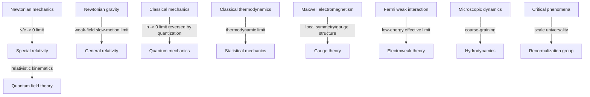

<!--
SPDX-FileCopyrightText: Copyright © 2026 Idiap Research Institute <contact@idiap.ch>

SPDX-FileContributor: Andre Freitas <andre.freitas@idiap.ch>
Neuro-symbolic AI Group

SPDX-FileContributor: Danilo Gusicuma <danilo.gusicuma@idiap.ch>
Neuro-symbolic AI Group

SPDX-License-Identifier: MIT
-->
# Dialectical Concept Solver: Physics Examples, Empirical Constraint, and Conceptual Discovery

## 0. Purpose

This document extends the solver-oriented dialectical concept model from mathematics to physics.

The mathematical version treated conceptual evolution as:

```text
concept -> determinate failure -> transformation -> successor concept -> proof obligations
```

For physics, this must be adapted. A physical concept is not only a formal theory. It is a package containing mathematical structure, empirical interpretation, measurement procedures, approximations, idealizations, regimes of validity, and links to instruments and data.

So the physics version becomes:

```text
physical concept
  -> anomaly / incompatibility / non-invariance / singularity / scale failure
  -> concept transformation or discovery
  -> successor concept
  -> mixed formal-empirical obligations
  -> limiting-case recovery of predecessor
```

The most important adaptation is this:

> In mathematics, conceptual development is often certified by proof. In physics, conceptual development is certified by a combination of proof, prediction, empirical adequacy, limiting-case recovery, dimensional consistency, invariance, stability, and explanatory compression.

The goal is not to make a solver that merely fits data. The goal is to make a solver that can propose, test, rank, and preserve physical concepts as structured scientific objects.

---

## 1. Physics-specific refinement of the core thesis

A physical theory or concept should be represented as a structured model with:

- state variables;
- observables;
- equations of motion;
- parameters;
- symmetries;
- conservation laws;
- measurement maps;
- empirical domain;
- validity regime;
- approximation hierarchy;
- limiting cases;
- known anomalies;
- protected predecessor concepts.

Physical conceptual evolution occurs when the current concept becomes inadequate for one or more of its intended roles.

The inadequacy may appear as:

- empirical residuals that cannot be removed by parameter adjustment;
- violation of a conservation principle;
- incompatibility between two successful theories;
- failure of covariance or invariance;
- singularities or divergences;
- lack of stability;
- dependence on arbitrary representation choices;
- inability to model a new scale;
- mismatch between microscopic and macroscopic descriptions;
- unexplained universality across different systems;
- recurring mathematical structure without a recognized physical interpretation.

Thus the solver must support both:

```text
anomaly-driven theory repair
```

and:

```text
pattern-driven conceptual discovery.
```

The physics version of dialectical development should be understood as **domain-preserving conceptual transformation**. Earlier concepts are rarely simply discarded. They are usually preserved as special cases, approximations, effective theories, or limiting regimes.

Examples:

```text
Newtonian mechanics survives inside special relativity when v/c -> 0.
Newtonian gravity survives inside general relativity in the weak-field, slow-motion limit.
Classical mechanics survives inside quantum mechanics in suitable semiclassical limits.
Thermodynamics survives inside statistical mechanics in the thermodynamic limit.
Fermi's weak interaction theory survives as a low-energy effective limit of electroweak theory.
```

This is the physics analogue of `Aufhebung`: cancellation of overreach, preservation of successful structure, and elevation into a broader theory.

---

## 2. Refined formal object: PhysicalConcept

A physics concept is not merely a signature plus axioms. It must contain both formal and empirical layers.

Let:

\[
C = (\Sigma, S, O, D, K, G, \Theta, M, R, B, A, E, X, P, H, \Omega)
\]

where:

| Component | Meaning |
|---|---|
| \(\Sigma\) | typed symbolic language: quantities, fields, particles, events, frames, manifolds, operators |
| \(S\) | state space: phase space, Hilbert space, configuration space, spacetime field configurations, probability distributions |
| \(O\) | observables and measurable quantities |
| \(D\) | dynamics: differential equations, variational principle, transition rules, path integral, evolution operator |
| \(K\) | kinematic structure: spacetime, reference frames, causal order, allowed transformations |
| \(G\) | symmetries and gauge redundancies |
| \(\Theta\) | parameters and constants, including dimensions and priors |
| \(M\) | measurement and observation model mapping theoretical objects to instrument readings |
| \(R\) | regime of validity: energy scale, velocity range, length scale, temperature, coupling strength, curvature, density |
| \(B\) | boundary and initial condition structure |
| \(A\) | axioms, constraints, constitutive laws, idealizations |
| \(E\) | evidence store: experiments, simulations, benchmark phenomena, known successes and failures |
| \(X\) | explanation targets: phenomena the concept is meant to explain, predict, classify, or unify |
| \(P\) | preservation obligations inherited from predecessor concepts |
| \(H\) | concept history: parent theories, transformations, anomaly traces, validation certificates |
| \(\Omega\) | allowed concept operators: quantize, geometrize, gauge, coarse-grain, renormalize, fieldify, unify, etc. |

A minimal implementation can start with a smaller schema:

```yaml
PhysicalConcept:
  name: string
  ontology:
    objects: list
    state_space: expression
    observables: list
  dynamics:
    equations: list
    variational_principle: optional
  symmetries:
    spacetime: list
    internal: list
    gauge: list
  parameters:
    constants: list
    units: list
    free_parameters: list
  measurement_model:
    observables_to_readings: list
    uncertainty_model: optional
  regime:
    assumptions: list
    validity_bounds: list
    limiting_cases: list
  evidence:
    successes: list
    anomalies: list
  preservation:
    predecessor_limits: list
    protected_predictions: list
  discovery_state:
    open_failures: list
    candidate_transforms: list
    concept_graph_edges: list
```

---

## 3. Task model for physics

A physics task is a demand placed on a concept.

\[
\tau = (name, kind, context, target, tolerance, regime, priority)
\]

Possible task kinds:

| Task kind | Meaning | Example |
|---|---|---|
| `predict` | derive a measurable outcome | compute planetary precession, scattering cross-section, spectrum |
| `fit` | estimate parameters from data | infer coupling, mass, equation-of-state parameter |
| `explain` | connect mechanism to phenomenon | explain blackbody spectrum or superconducting gap |
| `simulate` | generate numerical trajectories or fields | evolve fluid or field equations |
| `derive_limit` | recover predecessor theory | recover Newtonian mechanics from relativity |
| `check_invariance` | verify covariance or symmetry | Lorentz covariance, gauge invariance |
| `check_conservation` | verify conserved quantity | energy, momentum, charge |
| `stability` | check stable equilibria or bounded evolution | atomic stability, vacuum stability |
| `renormalize` | remove dependence on arbitrary cutoffs | scale-dependent couplings |
| `coarse_grain` | derive macroscopic laws from microscopic dynamics | hydrodynamics from kinetic theory |
| `classify` | classify phases, particles, solutions, universality classes | phases of matter, elementary representations |
| `unify` | identify common structure across phenomena | electricity and magnetism, electroweak interaction |
| `instrumentalize` | produce measurement procedure for theoretical quantity | operational definition of field or temperature |
| `discover` | propose hidden variable, field, symmetry, entity, or effective degree of freedom | neutrino, order parameter, gauge field |

Evaluation returns more than success or failure:

```text
Eval(C, task) ∈ {
  Success(certificate),
  Failure(failure_certificate),
  ApproxSuccess(residual, tolerance, regime),
  Unknown(reason),
  DiscoverySignal(signal)
}
```

In physics, an approximate success can be a valid result if the concept declares its regime correctly.

Example:

```text
Newtonian mechanics predicts accurately for v << c.
It should not be marked false inside its declared regime.
It should be marked overextended if used for v comparable to c.
```

Thus every prediction should be typed by regime.

---

## 4. Failure certificates as physical determinate negations

A physical failure certificate has the form:

\[
F = (label, witness, residual, violated\_obligation, regime, trace, uncertainty, repair\_target, severity)
\]

| Field | Meaning |
|---|---|
| `label` | failure type |
| `witness` | experiment, simulated case, theorem, singular solution, dimensional inconsistency, incompatible transformation |
| `residual` | quantitative discrepancy or formal violation |
| `violated_obligation` | exact task that failed |
| `regime` | scale and assumptions under which failure appears |
| `trace` | dependency path through equations, parameters, approximations, and measurement model |
| `uncertainty` | experimental or numerical uncertainty model |
| `repair_target` | kind of conceptual move suggested |
| `severity` | centrality relative to the concept's intended role |

Canonical physics failure labels:

| Label | Solver meaning | Typical transformation |
|---|---|---|
| `EmpiricalAnomaly` | prediction conflicts with robust observation | extension, latent entity, new dynamics |
| `Overextension` | theory used outside declared regime | regime restriction, effective theory edge |
| `NonCovariance` | equations depend on forbidden frame choice | invariantization, new kinematics |
| `SymmetryMismatch` | observed or required symmetry absent | symmetry extension, symmetry breaking, gauge principle |
| `ConservationViolation` | conservation law appears broken | new carrier, hidden degree of freedom, revised dynamics |
| `NonLocalConflict` | instantaneous influence conflicts with finite propagation | fieldification, relativistic reformulation |
| `Singularity` | quantity diverges or becomes undefined | regularization, new degrees of freedom, domain refinement |
| `UVFailure` | high-energy or short-distance divergence | quantization, cutoff, renormalization, EFT |
| `IRFailure` | long-distance or low-energy instability | collective variables, effective theory |
| `Instability` | predicted matter or vacuum is unstable contrary to observation | quantization, constraint, exclusion principle, new interaction |
| `RepresentationDependence` | physical prediction depends on arbitrary coordinates or gauge | quotient, invariant observable, gauge fixing plus invariance proof |
| `ScaleMismatch` | micro and macro descriptions do not connect | coarse-graining, statistical mechanics, RG |
| `ParameterAdHocness` | parameters are added without structure or independent tests | unification, symmetry principle, model compression |
| `NonRenormalizability` | predictive control fails at target scale | EFT declaration, UV completion, new theory |
| `NoLimitingCase` | successor candidate cannot recover old successes | reject candidate or add correspondence map |
| `MeasurementGap` | concept lacks operational measurement interface | measurement model enrichment |
| `ConceptualUnderdetermination` | many theories fit the same data | rank by prediction, simplicity, symmetry, new tests |

The key difference from mathematics is that a physical negation may be statistical and approximate, not deductive.

A failure is determinate only when it identifies:

```text
what failed,
where it failed,
under which assumptions,
relative to which measurement model,
and what kind of transformation could repair it.
```

---

## 5. Discovery signals in physics

Physics has conceptual discovery even when no single contradiction forces a new theory. A solver should detect patterns that suggest new concepts.

A discovery signal has the form:

\[
D = (label, evidence, latent\_structure, candidate\_concept, candidate\_operator, score)
\]

Physics discovery labels:

| Label | Meaning | Example |
|---|---|---|
| `InvariantPattern` | same quantity or structure survives transformations | conservation laws, Lorentz interval, gauge-invariant field strength |
| `SymmetryPattern` | many phenomena share transformation group | rotational invariance, internal symmetry, gauge symmetry |
| `UnificationPressure` | separate laws have same mathematical form | electricity + magnetism, weak + electromagnetic interactions |
| `LatentCarrier` | missing energy, charge, momentum, or information suggests unseen entity | neutrino-like discovery pattern |
| `FieldPattern` | action-at-distance phenomena are better represented locally | electromagnetic field, gravitational field |
| `GeometricPattern` | force-like effects can be encoded as geometry | gravity as spacetime curvature |
| `QuantizationPressure` | discrete spectra or stability require nonclassical observables | atomic spectra, blackbody radiation |
| `OrderParameterPattern` | macroscopic phase requires a collective variable | magnetization, superconducting condensate |
| `ScaleUniversality` | different systems share critical exponents or scaling laws | RG universality classes |
| `DualDescription` | two different models yield same observables | wave-particle duality, dualities in field theory |
| `EffectiveDegreePattern` | low-energy behavior ignores microscopic detail | quasiparticles, phonons, hydrodynamic variables |
| `VariationalCompression` | equations can be generated by a single action | Lagrangian/Hamiltonian unification |
| `GaugeRedundancy` | many mathematical states correspond to same physical state | vector potential gauge transformations |
| `AnomalyCluster` | multiple anomalies share a repair target | quantum theory from radiation, spectra, stability |

Discovery is not merely adding variables. It is proposing new ontology under constraints.

The solver should prefer discoveries that:

1. reduce residuals;
2. preserve previous successes;
3. produce new testable predictions;
4. increase symmetry or invariance;
5. reduce ad hoc assumptions;
6. clarify measurement operations;
7. create a better concept graph.

---

## 6. Development is a regime-labeled concept graph

In mathematics, concept development can often be drawn as a graph of embeddings, abstractions, quotients, and completions.

In physics, the graph must also encode **regimes** and **limits**.

An edge has the form:

\[
C_i \xrightarrow{trigger, operator, regime, limit, certificates} C_j
\]

The edge may mean:

- `extends`: successor covers a broader regime;
- `limits_to`: predecessor is recovered under a limit;
- `effective_of`: predecessor is an effective theory of successor;
- `dual_to`: two concepts are equivalent under a mapping;
- `coarse_grains_to`: microscopic concept yields macroscopic concept;
- `geometrizes`: force concept becomes geometric structure;
- `quantizes`: classical concept becomes quantum concept;
- `gauge_quotients`: redundant variables become physical equivalence classes;
- `unifies`: multiple concepts become aspects of one structure.

Example concept graph:



The graph is not a ladder of final truth. It is a network of concepts with validity domains and certified transition maps.

---

## 7. Physics version of Aufhebung

In the original model, `Aufhebung(C, F, C')` meant that a new concept `C'` resolves a failure of `C` while preserving `C` as a special case.

For physics, define:

\[
Aufhebung_{phys}(C,F,C')
\]

as a certified transformation satisfying the following obligations.

### 7.1 Empirical resolution

The successor must reduce or explain the anomaly in the stated regime.

```text
Residual(C', phenomenon, regime) < Residual(C, phenomenon, regime)
```

This comparison should include uncertainty and avoid overfitting.

### 7.2 Limiting-case preservation

The successor must recover the predecessor's successful predictions in the predecessor's regime.

```text
limit(C', limit_map) ≈ C on protected_tasks(C)
```

Examples:

```text
SR -> Newtonian mechanics as c -> infinity or v/c -> 0.
GR -> Newtonian gravity in weak fields and slow motion.
QM -> classical mechanics in semiclassical regimes.
Statistical mechanics -> thermodynamics as N -> infinity under suitable assumptions.
```

### 7.3 Conceptual non-collapse

The successor must not trivialize physical distinctions that are empirically meaningful.

Example:

```text
A gauge quotient may identify vector potentials differing by a gauge transform,
but it must not identify configurations with different electromagnetic fields.
```

### 7.4 Symmetry and invariance compatibility

The successor must implement the required transformations cleanly.

```text
For every allowed transformation g ∈ G:
    Observables(transform(state,g)) = transformed_observables(state,g)
```

### 7.5 Measurement interface

The successor must say how theoretical quantities become observables.

Example:

```text
A new latent particle concept must specify detectable couplings,
conservation signatures, or scattering/decay consequences.
```

### 7.6 Domain declaration

The successor must explicitly state its domain and avoid pretending to solve what it does not address.

```yaml
regime:
  valid_for: [low_energy, weak_coupling]
  not_valid_for: [Planck_scale, strong_curvature]
```

This is important because many physical concepts are effective, not final.

---

## 8. Transformation and discovery operators for physics

The solver should maintain a library of typed concept operators.

| Operator | Input trigger | Output concept type |
|---|---|---|
| `RestrictRegime` | overextension | effective theory with narrower domain |
| `InvariantizeKinematics` | non-covariance | new spacetime or transformation group |
| `GeometrizeInteraction` | force/inertia anomaly, equivalence pattern | metric/connection/curvature theory |
| `FieldifyActionAtDistance` | nonlocal conflict | local field theory |
| `QuantizeObservableAlgebra` | quantization pressure, stability failure | noncommutative observable theory |
| `IntroduceLatentCarrier` | conservation anomaly | new particle/field/degree of freedom |
| `GaugeQuotient` | representation dependence | gauge equivalence classes and invariant observables |
| `LocalizeSymmetry` | global symmetry plus interaction pressure | gauge field and covariant derivative |
| `UnifyInteractions` | common symmetry/interface | combined theory with shared group/action |
| `CoarseGrain` | scale mismatch | macro variables and effective equations |
| `Renormalize` | UV divergence/cutoff dependence | scale-dependent parameters and RG flow |
| `EffectiveFieldTheory` | unresolved high-energy physics | low-energy expansion with controlled operators |
| `IntroduceOrderParameter` | phase transition pattern | collective variable and broken symmetry |
| `SpontaneouslyBreakSymmetry` | symmetric law, asymmetric ground state | phase/particle spectrum with residual symmetry |
| `DualizeDescription` | two equivalent observable predictions | dual theory mapping |
| `VariationalCompress` | many equations share conservation/symmetry skeleton | action principle |
| `StatisticalizeMicrodynamics` | macro irreversibility and many degrees of freedom | ensembles, entropy, probability distributions |

A candidate transformation is not accepted until it passes the relevant obligations.

---

## 9. Physics examples that refine the model

The following examples are stylized. They are not meant as detailed historical reconstructions. They are designed to refine the solver architecture by showing what kind of typed failures, discoveries, transformations, and certificates are needed.

---

### 9.1 Newtonian mechanics to special relativity

#### Initial concept

```yaml
concept: NewtonianMechanics
state_space: positions and velocities in absolute time
kinematics:
  spacetime: Euclidean space + universal time
  transformations: Galilean transformations
dynamics:
  law: F = m a
observables:
  position, velocity, acceleration, momentum, energy
regime:
  valid_when: v << c, weak gravitational fields, macroscopic scales
```

#### Failure pressure

Newtonian kinematics assumes velocities add Galileanly and time is universal. But classical electrodynamics suggests a propagation speed that should be invariant, and high-speed phenomena require a different relation between space, time, and motion.

Typed failures:

```yaml
failure:
  label: NonCovariance
  witness: equations with invariant propagation speed not preserved by Galilean transformations
  violated_obligation: check_invariance(Maxwell-like propagation, GalileanGroup)
  repair_target: InvariantizeKinematics
```

```yaml
failure:
  label: EmpiricalAnomaly
  witness: high-speed / light-propagation phenomena incompatible with Galilean velocity addition
  violated_obligation: predict(frame_transformed_light_speed)
  repair_target: new spacetime transformation group
```

#### Transformation

```text
InvariantizeKinematics(NewtonianMechanics, invariant_speed = c)
```

Successor concept:

```yaml
concept: SpecialRelativity
kinematics:
  spacetime: Minkowski spacetime
  transformations: Lorentz transformations
  invariant: spacetime interval
observables:
  proper_time, four_velocity, four_momentum, invariant_mass
```

#### Preservation obligations

```text
recover(NewtonianMechanics, limit: v/c -> 0)
recover(GalileanVelocityAddition, limit: v/c -> 0)
recover(classical_kinetic_energy, leading_order_expansion)
```

#### Resolution obligations

```text
prove_or_verify(LorentzCovariance(MaxwellEquations))
verify(speed_c_invariant_across_inertial_frames)
```

#### Solver lesson

This example adds a new failure type:

```text
NonCovariance
```

and a new operator:

```text
InvariantizeKinematics
```

It also shows that a successor theory must recover predecessor predictions under a limiting parameter.

---

### 9.2 Newtonian gravity to general relativity

#### Initial concept

```yaml
concept: NewtonianGravity
ontology:
  objects: point masses in Euclidean space
kinematics:
  absolute time: true
  instantaneous_action: true
dynamics:
  gravitational_force: inverse_square_force
observables:
  trajectories, accelerations, orbital periods
regime:
  valid_when: weak fields, slow velocities, small curvature effects
```

#### Failure pressure

Newtonian gravity is extremely successful in its regime, but it treats gravity as an instantaneous force over absolute space and time. It also leaves the equality of inertial and gravitational mass conceptually unexplained. When combined with relativistic kinematics, instantaneous action becomes structurally problematic.

Typed failures:

```yaml
failure:
  label: NonLocalConflict
  witness: instantaneous gravitational influence incompatible with relativistic finite propagation
  violated_obligation: compatibility_with(SpecialRelativity)
  repair_target: FieldifyActionAtDistance or GeometrizeInteraction
```

```yaml
failure:
  label: GeometricPattern
  witness: universality of free fall and equivalence of inertial/gravitational mass
  violated_obligation: explain(equivalence_principle)
  repair_target: GeometrizeInteraction
```

```yaml
failure:
  label: EmpiricalAnomaly
  witness: small orbital deviations outside Newtonian prediction
  violated_obligation: high_precision_orbital_prediction
  repair_target: relativistic_gravity
```

#### Transformation

```text
GeometrizeInteraction(NewtonianGravity, equivalence_principle)
```

Successor concept:

```yaml
concept: GeneralRelativity
ontology:
  spacetime: differentiable manifold with metric tensor
  gravity: curvature / metric structure
dynamics:
  matter_energy_sources_geometry: field_equations
  free_fall: geodesic_motion
symmetries:
  diffeomorphism_covariance: true
```

#### Preservation obligations

```text
recover(NewtonianGravity, limit: weak_field and slow_motion)
recover(PoissonEquation, appropriate_limit)
recover(NewtonianFreeFall, local_limit)
```

#### Resolution obligations

```text
verify(local_equivalence_principle)
verify(finite_propagation_of_gravitational_degrees_of_freedom where applicable)
verify(improved_high_precision_orbital_predictions)
```

#### Solver lesson

This example adds:

```text
GeometrizeInteraction
```

as a concept operator and shows that conceptual discovery can come from an explanatory pattern, not only from raw anomaly.

---

### 9.3 Classical radiation to quantum energy exchange

#### Initial concept

```yaml
concept: ClassicalRadiationThermalEquilibrium
ontology:
  electromagnetic_modes: continuous classical degrees of freedom
  matter: classical emitters/absorbers
dynamics:
  energy_exchange: continuous
statistical_assumption:
  equipartition: applied_to_modes
```

#### Failure pressure

A purely classical treatment of radiation modes and thermal equilibrium leads to pathological high-frequency behavior and fails to account for observed spectral structure.

Typed failure:

```yaml
failure:
  label: UVFailure
  witness: divergent high-frequency energy density under classical equipartition
  violated_obligation: predict(finite_blackbody_spectrum)
  repair_target: QuantizeObservableAlgebra or QuantizeEnergyExchange
```

#### Transformation

```text
QuantizeEnergyExchange(classical_radiation, quantum_of_action = h)
```

Successor concept:

```yaml
concept: QuantumRadiationExchange
ontology:
  modes: discrete energy levels
  exchange_units: quanta
dynamics:
  energy_level_spacing: proportional_to_frequency
parameters:
  h: quantum_of_action
```

#### Preservation obligations

```text
recover(classical_radiation_behavior, limit: h -> 0 or large_occupation_numbers)
recover(RayleighJeans_low_frequency_limit, appropriate_regime)
```

#### Resolution obligations

```text
predict(finite_blackbody_spectrum)
fit(spectral_distribution_across_temperatures)
```

#### Solver lesson

This example refines `UVFailure` into a concept-generating trigger. It also motivates a general operator:

```text
QuantizeObservableAlgebra
```

or, more locally:

```text
QuantizeEnergyExchange
```

---

### 9.4 Classical mechanics to quantum mechanics

#### Initial concept

```yaml
concept: ClassicalMechanics
state_space: phase_space(q,p)
observables: functions_on_phase_space
dynamics: Hamiltonian_flow
logic:
  observables_commute: true
  states_have_definite_q_and_p: true
```

#### Failure pressure

Classical mechanics cannot naturally represent stable atoms, discrete spectra, interference phenomena, or measurement outcomes that resist simultaneous assignment of all classical observables.

Typed failures:

```yaml
failure:
  label: Instability
  witness: classical orbiting charges radiate and collapse under naive classical electromagnetic assumptions
  violated_obligation: explain(stable_atoms)
  repair_target: QuantizeObservableAlgebra
```

```yaml
failure:
  label: QuantizationPressure
  witness: discrete spectra and interference
  violated_obligation: explain(spectral_lines, interference_patterns)
  repair_target: noncommutative_observables
```

#### Transformation

```text
QuantizeObservableAlgebra(ClassicalMechanics)
```

Conceptual move:

```text
phase-space observables -> operators
Poisson bracket -> commutator deformation
state point -> vector/ray/density operator
classical probability -> quantum amplitude and Born probabilities
```

Successor:

```yaml
concept: QuantumMechanics
state_space: Hilbert_space
observables: self_adjoint_operators
dynamics: Schrödinger_equation_or_unitary_evolution
measurement: probabilistic_outcomes
noncommutativity: [q,p] = i*hbar
```

#### Preservation obligations

```text
recover(ClassicalMechanics, limit: hbar -> 0)
recover(Hamiltonian_flow, semiclassical_limit)
recover(Ehrenfest_like_mean_dynamics, appropriate_states)
```

#### Resolution obligations

```text
predict(discrete_bound_state_spectra)
explain(interference)
explain(stability_under_quantum_ground_states)
```

#### Solver lesson

This example requires the solver to allow **deformation** as a conceptual operator:

```text
DeformAlgebra(commutative_observables, deformation_parameter = hbar)
```

It also demonstrates that physical discovery may require changing the logic of observables, not merely adding objects.

---

### 9.5 Particle mechanics to quantum field theory

#### Initial concepts

```yaml
concepts:
  - SpecialRelativity
  - QuantumMechanics
```

The initial attempt is to combine relativistic kinematics with quantum states of fixed particle number.

#### Failure pressure

Relativistic physics permits particle creation and annihilation when sufficient energy is available. Fixed-particle quantum mechanics cannot naturally represent changing particle number or local relativistic field excitations.

Typed failures:

```yaml
failure:
  label: IncompatibilityBetweenConcepts
  witness: relativistic energy plus quantum transitions require variable particle number
  violated_obligation: model(pair_creation_annihilation)
  repair_target: FieldifyParticles
```

```yaml
failure:
  label: LocalityPressure
  witness: need local degrees of freedom compatible with relativistic causal structure
  violated_obligation: compatibility_with(relativistic_locality)
  repair_target: QuantumFieldify
```

#### Transformation

```text
FieldifyParticles(QuantumMechanics + SpecialRelativity)
```

Successor:

```yaml
concept: QuantumFieldTheory
ontology:
  fields: operator-valued or path-integral degrees of freedom
  particles: excitations/quanta of fields
state_space: Fock_space_or_general_QFT_state_space
dynamics: local_action_or_Hamiltonian_density
symmetries: Poincare_covariance plus internal symmetries
```

#### Preservation obligations

```text
recover(nonrelativistic_quantum_mechanics, limit: low_energy and fixed_particle_number)
recover(special_relativity_for_single_free_particles, appropriate_limit)
```

#### Resolution obligations

```text
represent(particle_creation_annihilation)
verify(relativistic_covariance)
verify(appropriate_locality_or_microcausality_conditions where formalism supports them)
```

#### Solver lesson

The solver needs a transformation that turns particles from primitive objects into excitations of fields:

```text
FieldifyParticles
```

This is a conceptual elevation: the old particle concept is preserved, but no longer fundamental in the same way.

---

### 9.6 Gauge redundancy in electromagnetism

#### Initial concept

```yaml
concept: ElectromagneticPotentialDescription
variables:
  scalar_potential: phi
  vector_potential: A
observable_fields:
  E: derived_from(phi, A)
  B: curl(A)
```

#### Failure pressure

Different potentials can produce the same electric and magnetic fields. If the solver treats all potential configurations as physically distinct, it overcounts states and makes predictions representation-dependent.

Typed failure:

```yaml
failure:
  label: RepresentationDependence
  witness: gauge_related_potentials_same_E_and_B
  violated_obligation: physical_distinction_must_affect_observables
  repair_target: GaugeQuotient
```

#### Transformation

```text
GaugeQuotient(PotentialConfigurations)
```

Successor concept:

```yaml
concept: GaugeEquivalenceElectromagnetism
state_space: gauge_orbits_of_potentials or gauge_invariant_fields
observables: gauge_invariant_quantities
redundancy: A -> A + grad(lambda), phi -> phi - d(lambda)/dt
```

#### Preservation obligations

```text
preserve(E_fields)
preserve(B_fields)
preserve(Lorentz_force_predictions)
```

#### Resolution obligations

```text
verify(gauge_related_configurations_have_same_observables)
prevent(overcounting_in_state_space)
```

#### Solver lesson

This example refines the mathematical `Rigidity`/`NonInvariance` pattern into a physical operator:

```text
GaugeQuotient
```

It also adds an important safety rule:

```text
Never treat representation variables as physical unless observables distinguish them.
```

---

### 9.7 From global symmetry to gauge interaction

#### Initial concept

```yaml
concept: MatterFieldWithGlobalSymmetry
state_space: fields transforming under internal group G
symmetry:
  global_G: true
  local_G: false
dynamics: free_or_interacting_matter_lagrangian
```

#### Discovery pressure

If a matter field theory has a global internal symmetry, the solver may ask whether the symmetry can be made local. Localizing the symmetry usually requires new compensating fields and covariant derivatives.

Discovery signal:

```yaml
discovery_signal:
  label: LocalSymmetryPressure
  evidence: global symmetry plus demand for local transformation freedom
  latent_structure: connection/gauge_field
  candidate_operator: LocalizeSymmetry
```

#### Transformation

```text
LocalizeSymmetry(global_G)
```

Conceptual move:

```text
ordinary derivative -> covariant derivative
new field introduced -> gauge connection
field strength -> curvature of connection
interaction -> required by local symmetry
```

Successor:

```yaml
concept: GaugeInteractionTheory
symmetry:
  local_G: true
new_objects:
  gauge_field: connection
  field_strength: curvature
observables:
  gauge_invariant_quantities
```

#### Preservation obligations

```text
recover(global_symmetry_when_gauge_transformations_are_constant)
recover(free_theory_when_coupling -> 0)
```

#### Resolution obligations

```text
verify(local_gauge_invariance)
verify(observables_are_gauge_invariant)
```

#### Solver lesson

This is conceptual discovery from symmetry, not anomaly. The solver needs to generate new fields when a local invariance demand cannot otherwise be satisfied.

---

### 9.8 Fermi weak interaction to electroweak theory

#### Initial concept

```yaml
concept: FermiWeakInteraction
ontology:
  interaction: local_four_fermion_contact
domain:
  valid_for: low_energy_weak_processes
parameters:
  coupling: effective_constant
```

#### Failure pressure

A contact interaction can be highly successful at low energy while becoming structurally inadequate when extrapolated to higher energies. The failure is not that the low-energy theory is useless; it is that it lacks controlled high-energy behavior and deeper symmetry structure.

Typed failures:

```yaml
failure:
  label: NonRenormalizability
  witness: high_energy_extrapolation_loses_predictive_control
  violated_obligation: maintain_predictivity_at_target_scale
  repair_target: UVCompletion or GaugeUnification
```

```yaml
failure:
  label: ParameterAdHocness
  witness: effective coupling without mediating structure
  violated_obligation: explain(interaction_origin)
  repair_target: IntroduceMediatorField
```

#### Transformation

```text
GaugeUnification(FermiWeakInteraction, Electromagnetism)
```

or:

```text
IntroduceMediatorField(contact_interaction)
```

Successor:

```yaml
concept: ElectroweakTheory
ontology:
  weak_and_electromagnetic_interactions: unified_gauge_structure
  mediator_bosons: gauge_fields_after_symmetry_breaking
  masses: generated_through_symmetry_breaking_mechanism
low_energy_limit:
  recovers: FermiWeakInteraction
```

#### Preservation obligations

```text
recover(Fermi_contact_interaction, limit: energies << mediator_mass_scale)
recover(electromagnetic_interaction, appropriate_unbroken_sector)
```

#### Resolution obligations

```text
improve(high_energy_behavior)
verify(gauge_structure)
predict(new_mediators_or_relations_if_not_already_in_evidence)
```

#### Solver lesson

This example shows that a concept can be valid and yet incomplete. The model should distinguish:

```text
False theory
```

from:

```text
Effective theory valid in a bounded regime.
```

This forces the concept graph to encode `effective_of` and `low_energy_limit` edges.

---

### 9.9 Beta decay and the latent carrier pattern

#### Initial concept

```yaml
concept: NuclearBetaDecayWithoutNeutralLepton
ontology:
  initial_nucleus: known
  final_nucleus: known
  emitted_particle: electron_or_beta_particle
conservation:
  energy: expected
  momentum: expected
  angular_momentum: expected
```

#### Failure pressure

A decay model with too few outgoing degrees of freedom can appear to violate conservation laws or produce continuous spectra where a simpler two-body model would not.

Typed failure:

```yaml
failure:
  label: ConservationViolation
  witness: missing_energy_momentum_angular_momentum_pattern
  violated_obligation: conserve(energy, momentum, angular_momentum)
  repair_target: IntroduceLatentCarrier
```

#### Transformation

```text
IntroduceLatentCarrier(
  properties = {
    neutral: true,
    weakly_interacting: true,
    carries_energy_momentum: true,
    spin_constraint: inferred
  }
)
```

Successor:

```yaml
concept: BetaDecayWithNeutrinoLikeCarrier
ontology:
  emitted_particles:
    - electron_or_positron
    - neutral_weakly_interacting_lepton
conservation:
  restored: [energy, momentum, angular_momentum]
measurement_model:
  direct_detection: difficult
  indirect_signature: missing_energy_momentum
```

#### Preservation obligations

```text
preserve(observed_beta_decay_rates_with_revised_kinematics)
preserve(charge_conservation)
```

#### Resolution obligations

```text
fit(continuous_energy_spectrum)
restore(conservation_laws)
produce(testable_detection_or_interaction_predictions)
```

#### Solver lesson

This example introduces a key discovery operator:

```text
IntroduceLatentCarrier
```

But it must be heavily constrained. Otherwise the solver could invent arbitrary hidden entities. The operator should be allowed only when it improves multiple conservation/invariance obligations and creates new testable consequences.

---

### 9.10 Thermodynamics to statistical mechanics

#### Initial concept

```yaml
concept: ClassicalThermodynamics
state_variables:
  temperature, pressure, volume, entropy, internal_energy
dynamics:
  laws: phenomenological_macroscopic_laws
ontology:
  microscopic_degrees: absent_or_implicit
```

#### Failure and discovery pressure

Thermodynamics is powerful but phenomenological. It does not by itself explain why entropy has the form it has, how temperature arises from microscopic motion, or how fluctuations occur in finite systems.

Typed discovery signal:

```yaml
discovery_signal:
  label: ScaleMismatch
  evidence: macro laws stable despite many possible microscopic configurations
  latent_structure: probability_distribution_over_microstates
  candidate_operator: StatisticalizeMicrodynamics
```

Typed failure:

```yaml
failure:
  label: MeasurementGap
  witness: temperature_and_entropy_defined_macroscopically_without_micro_model
  violated_obligation: explain(macro_state_variables)
  repair_target: micro_to_macro_bridge
```

#### Transformation

```text
StatisticalizeMicrodynamics(Thermodynamics + Mechanics)
```

Successor:

```yaml
concept: StatisticalMechanics
ontology:
  microstates: many_body_configurations
  macrostates: equivalence_classes_or_distributions
tools:
  ensembles: microcanonical, canonical, grand_canonical
  entropy: measure_of_multiplicity_or_information
regime:
  thermodynamic_limit: important
```

#### Preservation obligations

```text
recover(thermodynamic_laws, limit: large_N and suitable_equilibrium_assumptions)
recover(equations_of_state, appropriate_models)
```

#### Resolution obligations

```text
explain(temperature_as_statistical_quantity)
explain(entropy_as_macro_multiplicity_or_information)
predict(fluctuations_for_finite_systems)
```

#### Solver lesson

This example requires two model adaptations:

1. the successor may derive predecessor laws only statistically or asymptotically;
2. the solver must represent coarse-graining maps from microstates to macrostates.

---

### 9.11 Kinetic theory to hydrodynamics

#### Initial concept

```yaml
concept: MicroscopicOrKineticDescription
state:
  distribution_function_or_particle_states
dynamics:
  microscopic_evolution_or_Boltzmann_like_equation
```

#### Discovery pressure

Many macroscopic systems are described by a small number of fields such as density, velocity, pressure, and temperature, despite enormous microscopic complexity.

Discovery signal:

```yaml
discovery_signal:
  label: EffectiveDegreePattern
  evidence: macro behavior depends on conserved densities and gradients, not microscopic details
  latent_structure: hydrodynamic_fields
  candidate_operator: CoarseGrain
```

#### Transformation

```text
CoarseGrain(micro_dynamics, slow_variables = conserved_densities)
```

Successor:

```yaml
concept: Hydrodynamics
state_variables:
  density, velocity_field, pressure, temperature
equations:
  continuity_equation
  momentum_balance
  energy_balance
constitutive_relations:
  viscosity, thermal_conductivity
regime:
  long_wavelength: true
  local_equilibrium: assumed
```

#### Preservation obligations

```text
derive(conservation_laws_from_microdynamics)
recover(transport_coefficients_or_parameterize_them)
declare_breakdown(Knudsen_number_large)
```

#### Resolution obligations

```text
predict(macroscopic_flow_patterns)
explain(universality_of_continuum_description)
```

#### Solver lesson

This example refines the concept graph with `coarse_grains_to` edges and requires explicit **breakdown conditions**.

A hydrodynamic concept should not be punished for failing at scales where the continuum approximation is invalid. It should be punished only if it fails inside its declared regime.

---

### 9.12 Critical phenomena and renormalization group

#### Initial concept

```yaml
concept: MeanFieldOrMicroscopicCriticalModel
ontology:
  many_degrees_of_freedom
parameters:
  temperature, coupling, external_field
prediction_targets:
  phase_transition_behavior, critical_exponents
```

#### Failure and discovery pressure

Different physical systems can display the same large-scale behavior near criticality. Microscopic details become irrelevant, while scale transformations and fixed points become central.

Typed discovery:

```yaml
discovery_signal:
  label: ScaleUniversality
  evidence: different systems share critical exponents and scaling forms
  latent_structure: renormalization_group_flow
  candidate_operator: Renormalize
```

Typed failure:

```yaml
failure:
  label: ScaleMismatch
  witness: microscopic model details fail to explain universal macro scaling directly
  violated_obligation: classify(universality_classes)
  repair_target: RGFlowConcept
```

#### Transformation

```text
Renormalize(model_family)
```

Successor:

```yaml
concept: RenormalizationGroupDescription
objects:
  scale_transformations
  running_couplings
  fixed_points
  relevant_irrelevant_marginal_directions
classification:
  universality_classes
```

#### Preservation obligations

```text
recover(original_model_at_initial_scale)
preserve(partition_function_or_observable_equivalence_under_coarse_graining where applicable)
```

#### Resolution obligations

```text
classify(critical_behavior_by_fixed_points)
explain(universality_despite_micro_differences)
compute_or_estimate(critical_exponents)
```

#### Solver lesson

This example creates one of the most important physics-specific refinements:

```text
Concepts can evolve by changing the scale at which they are represented.
```

The solver must reason about flows in theory space, not just individual theories.

---

### 9.13 Renormalization in quantum field theory

#### Initial concept

```yaml
concept: NaivePerturbativeQuantumFieldTheory
calculation:
  perturbative_expansion
problem:
  integrals_over_all_momenta
```

#### Failure pressure

Perturbative calculations can produce divergent integrals or dependence on arbitrary cutoffs. If unmanaged, this destroys predictive control.

Typed failure:

```yaml
failure:
  label: UVFailure
  witness: divergent_loop_integrals_or_cutoff_dependence
  violated_obligation: finite_regime_predictions
  repair_target: RegularizeThenRenormalize
```

#### Transformation

```text
Renormalize(QFT, scale = mu)
```

Successor:

```yaml
concept: RenormalizedQuantumFieldTheory
objects:
  renormalized_parameters
  counterterms
  scale_dependence
  beta_functions
obligation:
  physical_predictions_independent_of_unphysical_cutoff
```

#### Preservation obligations

```text
recover(low_order_successes_after_parameter_matching)
preserve(symmetries_required_by_theory where regularization permits)
```

#### Resolution obligations

```text
verify(finite_predictions_for_target_observables)
verify(cutoff_independence_after_renormalization_within_tolerance)
track(running_couplings)
```

#### Solver lesson

This example distinguishes:

```text
mathematical divergence
```

from:

```text
physical failure.
```

A divergence is a failure certificate only relative to an intended predictive task. A successful renormalization may turn the failure into a scale-aware concept.

---

### 9.14 Classical field concept to gauge field concept

#### Initial concept

```yaml
concept: ClassicalField
objects:
  field_values_assigned_to_spacetime_points
dynamics:
  partial_differential_equations
```

#### Discovery pressure

Some fields are not merely values over spacetime; they encode how internal degrees of freedom are compared from point to point. This suggests connection-like structures and curvature-like field strengths.

Discovery signal:

```yaml
discovery_signal:
  label: GeometricGaugePattern
  evidence: local internal transformations require comparison rules between neighboring points
  latent_structure: connection_and_curvature
  candidate_operator: GaugeGeometrize
```

#### Transformation

```text
GaugeGeometrize(field_theory)
```

Successor:

```yaml
concept: GaugeFieldAsConnection
objects:
  principal_or_associated_bundle_like_structure
  connection: gauge_potential
  curvature: field_strength
observables:
  gauge_invariant_curvature_or_holonomy_like_quantities
```

#### Preservation obligations

```text
recover(classical_field_equations_in_chosen_gauge_or_representation)
preserve(gauge_invariant_observables)
```

#### Resolution obligations

```text
verify(local_gauge_covariance)
verify(representation_independence)
```

#### Solver lesson

Gauge theory requires the solver to separate:

```text
mathematical description variables
```

from:

```text
physical observable structure.
```

This is the physical analogue of quotienting by equivalence, but with empirical observables controlling the quotient.

---

### 9.15 Superconductivity and the order parameter concept

#### Initial concept

```yaml
concept: NormalConductorModel
ontology:
  electrons, lattice, scattering
targets:
  resistivity, current_response
```

#### Failure pressure

A normal conduction picture does not explain zero resistance, magnetic flux expulsion, energy gap behavior, and macroscopic phase coherence in superconducting materials.

Typed failures:

```yaml
failure:
  label: EmpiricalAnomaly
  witness: zero_resistance_and_Meissner_effect
  violated_obligation: explain(superconducting_phase)
  repair_target: IntroduceOrderParameter
```

```yaml
discovery_signal:
  label: OrderParameterPattern
  evidence: phase transition with collective macroscopic coherence
  latent_structure: complex_order_parameter
  candidate_operator: IntroduceOrderParameter
```

#### Transformation

```text
IntroduceOrderParameter(superconducting_phase)
```

Possible successor concepts at different depths:

```yaml
concept: PhenomenologicalSuperconductivity
objects:
  complex_order_parameter
  electromagnetic_coupling
explains:
  Meissner_effect, coherence_length, penetration_depth
```

and a deeper microscopic concept:

```yaml
concept: MicroscopicPairingTheory
objects:
  paired_fermionic_degrees_of_freedom
  condensate_state
explains:
  gap, collective_coherence, low_temperature_behavior
```

#### Preservation obligations

```text
recover(normal_conducting_behavior_outside_superconducting_phase)
recover(phenomenological_parameters_from_micro_model where possible)
```

#### Resolution obligations

```text
explain(zero_resistance)
explain(Meissner_effect)
explain(energy_gap)
predict(critical_temperature_relations_or_material_dependent_patterns within model scope)
```

#### Solver lesson

This example adds:

```text
IntroduceOrderParameter
```

as a discovery operator for phases of matter. The solver should search for collective variables when many microscopic degrees of freedom produce coherent macro behavior.

---

### 9.16 Wave-particle duality as dual description pressure

#### Initial concepts

```yaml
concepts:
  - ClassicalParticle
  - ClassicalWave
```

#### Failure pressure

Some phenomena exhibit localized detection events while also producing interference patterns. Neither classical particle nor classical wave concepts alone capture the full behavior.

Typed failure:

```yaml
failure:
  label: DualDescriptionPressure
  witness: interference_with_discrete_detection_events
  violated_obligation: explain(both_interference_and_localized_detection)
  repair_target: ProbabilisticAmplitudeTheory
```

#### Transformation

```text
UnifyDualDescriptions(wave_model, particle_model)
```

Successor:

```yaml
concept: QuantumAmplitudeDescription
ontology:
  state: amplitude_or_vector
  measurement: probabilistic_event
features:
  interference: from amplitude_superposition
  discreteness: from measurement_outcomes_or_quanta
```

#### Preservation obligations

```text
recover(wave_interference_in_probability_distributions)
recover(particle_like_localized_detection_statistics)
```

#### Resolution obligations

```text
predict(interference_pattern)
predict(discrete_detection_events)
```

#### Solver lesson

The solver needs to support **dual-aspect unification**: when two concepts each preserve part of the evidence, the successor may not simply choose one but re-express both as limiting or observational aspects of a deeper formalism.

---

### 9.17 Conservation laws and Noether-style discovery

#### Initial observations

Many theories contain conserved quantities:

```text
energy, momentum, angular momentum, charge
```

#### Discovery pressure

Conservation laws often correlate with continuous symmetries of the action or equations.

Discovery signal:

```yaml
discovery_signal:
  label: InvariantPattern
  evidence:
    - time_translation_invariance correlates with energy conservation
    - spatial_translation_invariance correlates with momentum conservation
    - rotational_invariance correlates with angular_momentum conservation
  latent_structure: symmetry_conservation_correspondence
  candidate_operator: VariationalCompress
```

#### Transformation

```text
VariationalCompress(equations, symmetries)
```

Successor:

```yaml
concept: SymmetryConservationFramework
objects:
  action
  continuous_symmetry_group
  conserved_current_or_quantity
obligations:
  derive_conservation_from_symmetry
```

#### Preservation obligations

```text
recover(known_conserved_quantities)
recover(equations_of_motion_from_action where available)
```

#### Resolution obligations

```text
infer(conservation_law_from_symmetry)
infer(symmetry_candidate_from_conservation_pattern)
```

#### Solver lesson

This example supports a discovery mechanism that is not anomaly-based. The solver can propose a new organizing concept because it compresses many regularities.

---

### 9.18 From force laws to variational mechanics

#### Initial concept

```yaml
concept: ForceBasedMechanics
objects:
  forces, masses, accelerations
equations:
  F = m a
```

#### Discovery pressure

Many mechanical systems can be derived from a common variational principle. Constraints, generalized coordinates, symmetries, and conservation laws are handled more uniformly in a Lagrangian or Hamiltonian framework.

Discovery signal:

```yaml
discovery_signal:
  label: VariationalCompression
  evidence: many equations of motion generated by stationary action
  latent_structure: action_functional
  candidate_operator: VariationalCompress
```

#### Transformation

```text
VariationalCompress(ForceBasedMechanics)
```

Successor:

```yaml
concept: LagrangianHamiltonianMechanics
objects:
  Lagrangian, action, generalized_coordinates, canonical_momenta, Hamiltonian
advantages:
  handles_constraints
  exposes_symmetries
  connects_to_quantization
```

#### Preservation obligations

```text
recover(NewtonsSecondLaw, simple_cartesian_case)
recover(energy_conservation_for_time_translation_symmetry)
```

#### Resolution obligations

```text
derive(equations_of_motion_from_stationary_action)
handle(constrained_systems)
connect(symmetries_to_conserved_quantities)
```

#### Solver lesson

This example adds a transformation that increases conceptual compression without necessarily correcting a failed prediction.

```text
Conceptual discovery can be justified by proof compression and transfer power.
```

---

### 9.19 Equation of state to universality class

#### Initial concept

```yaml
concept: MaterialSpecificEquationOfState
parameters:
  material_dependent_coefficients
prediction:
  pressure_volume_temperature_relations
```

#### Discovery pressure

Near some phase transitions, material details matter less than dimension, symmetry, and order parameter structure.

Discovery signal:

```yaml
discovery_signal:
  label: ScaleUniversality
  evidence: similar scaling behavior across different materials
  latent_structure: universality_class
  candidate_operator: ClassifyByRelevantFeatures
```

#### Transformation

```text
ClassifyByRelevantFeatures(models, features = [dimension, symmetry, order_parameter])
```

Successor:

```yaml
concept: UniversalityClass
objects:
  families_of_systems_with_same_large_scale_behavior
invariants:
  critical_exponents
  scaling_functions
```

#### Preservation obligations

```text
preserve(material_specific_predictions_away_from_universal_regime as separate effective concepts)
recover(universal_scaling_near_critical_point)
```

#### Resolution obligations

```text
classify(materials_by_universal_features)
predict(shared_scaling_exponents)
```

#### Solver lesson

This example reinforces that conceptual evolution often moves from object-specific laws to equivalence classes of systems.

---

### 9.20 Effective theories as legitimate concepts

#### Initial solver mistake

A naive solver may rank only theories that claim universal validity. Physics requires a different approach.

Many concepts are valid precisely because they declare a bounded regime:

```text
Newtonian mechanics: low velocity, weak gravity.
Hydrodynamics: long wavelength, local equilibrium.
Fermi theory: low-energy weak processes.
Effective field theories: below cutoff scale.
Thermodynamics: macroscopic equilibrium or near-equilibrium regimes.
```

#### Refined concept

```yaml
concept: EffectiveTheory
required_fields:
  cutoff_or_domain
  degrees_of_freedom
  expansion_parameters
  matching_conditions
  error_terms
  excluded_regimes
```

#### Obligations

```text
state_validity_domain
bound_or_estimate_error_terms
recover_observed_predictions_within_domain
refuse_or_flag_predictions_outside_domain
connect_to_deeper_theory_if_known_or_mark_unknown
```

#### Solver lesson

The model must distinguish:

```text
concept failure inside valid regime
```

from:

```text
concept failure caused by invalid extrapolation.
```

This is central to physics-oriented conceptual reasoning.

---

## 10. Refined failure taxonomy from physics examples

The examples suggest the following physics-specific failure taxonomy.

| Failure label | Diagnostic question | Example repair |
|---|---|---|
| `EmpiricalAnomaly` | Does the prediction fail robustly against observation? | new dynamics, latent carrier, new regime |
| `NonCovariance` | Does the law change form under required transformations? | new kinematics, invariantization |
| `NonLocalConflict` | Does the theory require instantaneous influence where finite propagation is required? | field theory, relativistic reformulation |
| `Instability` | Does the concept predict unstable matter/vacuum contrary to observed stability? | quantization, exclusion, new constraints |
| `UVFailure` | Does the model diverge at high frequency/short distance? | quantization, regularization, renormalization |
| `IRFailure` | Does the model fail at large distance/low energy/collective scale? | effective variables, phase concept, RG |
| `RepresentationDependence` | Do predictions depend on arbitrary coordinates/gauge? | invariantization, quotient |
| `ScaleMismatch` | Can the concept connect micro and macro regimes? | coarse-graining, statistical mechanics |
| `ConservationViolation` | Are conservation laws apparently broken? | new carrier, revised interaction |
| `NonRenormalizability` | Does predictive control fail at target energy? | EFT declaration or UV completion |
| `ParameterAdHocness` | Are parameters fitted without structural explanation? | unification, symmetry, mediator fields |
| `MeasurementGap` | Can the theoretical quantity be measured or operationalized? | measurement model enrichment |
| `NoLimitingCase` | Does a proposed successor fail to recover old successes? | reject candidate |
| `Overextension` | Is the theory being used outside its declared domain? | restrict regime, add effective edge |
| `DualDescriptionPressure` | Do two incompatible pictures each capture robust evidence? | deeper unifying formalism |
| `AnomalyCluster` | Do multiple failures suggest one hidden cause? | concept discovery search |

---

## 11. Refined proof and validation obligations

The mathematics model used proof obligations. The physics model uses **mixed obligations**.

### 11.1 Formal obligations

```text
dimensional_consistency(C)
well_posedness(C, regime)
symmetry_covariance(C, G)
gauge_independence(C)
conservation_laws(C)
constraint_preservation(C)
limiting_case_recovery(C, predecessor)
stability(C, regime)
causality_or_locality(C, regime)
unitarity_if_quantum(C)
renormalizability_or_EFT_control(C, target_scale)
```

### 11.2 Empirical obligations

```text
fit_known_data(C, evidence_set)
predict_novel_observable(C, target)
out_of_sample_validation(C)
uncertainty_calibration(C)
robustness_to_noise(C)
measurement_model_validity(C)
```

### 11.3 Explanatory obligations

```text
reduce_ad_hoc_parameters(C)
unify_previously_separate_concepts(C)
derive_phenomenological_law_from_deeper_structure(C)
classify_many_cases_with_fewer_principles(C)
identify_breakdown_conditions(C)
```

### 11.4 Preservation obligations

```text
for each predecessor P:
    identify limit_map L: C -> P
    prove_or_verify approximate_equivalence(C under L, P, protected_tasks(P))
    preserve empirical successes of P within P.regime
```

### 11.5 Anti-overfitting obligations

```text
penalize_unmeasurable_latent_entities
penalize_free_parameters_without_independent_constraints
require_new_tests_for_hidden_carriers
require_model_comparison_against simpler alternatives
```

---

## 12. Candidate ranking for physics concepts

A candidate successor concept should be ranked by a composite score.

\[
Score(C') =
  w_e E(C')
+ w_l L(C')
+ w_s S(C')
+ w_p P(C')
+ w_c Cmp(C')
+ w_r R(C')
- w_a A(C')
- w_k K(C')
\]

where:

| Term | Meaning |
|---|---|
| \(E(C')\) | empirical adequacy and residual reduction |
| \(L(C')\) | limiting-case recovery of predecessors |
| \(S(C')\) | symmetry/invariance improvement |
| \(P(C')\) | predictive novelty and testability |
| \(Cmp(C')\) | compression/unification of concepts |
| \(R(C')\) | robustness across regimes and data perturbations |
| \(A(C')\) | ad hocness penalty |
| \(K(C')\) | complexity penalty, including unnecessary ontology |

Candidate acceptance should require hard gates before soft ranking:

```text
HARD_GATES:
  dimensional_consistency
  no_uncontrolled_internal_contradiction
  declared_regime
  measurement_interface_for_new_observables
  predecessor_recovery_or_explanation_of_why_not
```

Then score competing candidates.

---

## 13. Physics-aware concept graph schema

```yaml
ConceptGraph:
  nodes:
    - PhysicalConcept
  edges:
    - source: concept_id
      target: concept_id
      relation: one_of[
        extends,
        limits_to,
        effective_of,
        coarse_grains_to,
        quantizes,
        geometrizes,
        gauge_quotients,
        unifies,
        dual_to,
        breaks_symmetry_to,
        renormalizes_to,
        introduces_latent_carrier
      ]
      trigger:
        type: failure_or_discovery_signal
        id: string
      operator: string
      regime:
        valid_when: list
        invalid_when: list
      certificates:
        formal: list
        empirical: list
        preservation: list
        measurement: list
      status: proposed | validated | effective | provisional | rejected
```

Example edge:

```yaml
edge:
  source: NewtonianMechanics
  target: SpecialRelativity
  relation: limits_to
  trigger:
    type: NonCovariance
    id: invariant_light_speed_pressure
  operator: InvariantizeKinematics
  regime:
    predecessor_valid_when: v_over_c << 1
    successor_valid_when: inertial_frames_without_gravity
  certificates:
    preservation:
      - recover_Newtonian_velocity_addition_low_v
      - recover_classical_kinetic_energy_low_v
    formal:
      - Lorentz_covariance
```

---

## 14. Data schemas

### 14.1 PhysicalConcept schema

```yaml
PhysicalConcept:
  id: string
  name: string
  ontology:
    entities: list
    fields: list
    spacetime_structure: optional
    state_space: expression
  quantities:
    observables: list
    latent_variables: list
    units: mapping
  dynamics:
    equations: list
    action: optional
    constraints: list
    stochastic_rules: optional
  symmetries:
    spacetime: list
    internal: list
    gauge: list
    broken: list
  parameters:
    constants: list
    fitted: list
    derived: list
  measurement:
    maps: list
    uncertainty_model: optional
    instruments: optional
  regime:
    assumptions: list
    validity_bounds: list
    expansion_parameters: list
    breakdown_conditions: list
  evidence:
    successes: list
    anomalies: list
    benchmark_datasets: list
  preservation:
    predecessors: list
    limiting_maps: list
    protected_tasks: list
  discovery:
    signals: list
    candidate_operators: list
  status:
    maturity: proposed | effective | validated | provisional | rejected
```

### 14.2 FailureCertificate schema

```yaml
FailureCertificate:
  id: string
  label: string
  concept: concept_id
  witness:
    type: experiment | theorem | simulation | dimensional_check | inconsistency | singular_solution
    description: string
    data_ref: optional
  residual:
    value: optional
    tolerance: optional
    uncertainty: optional
  violated_obligation: string
  regime:
    assumptions: list
    scale: optional
  trace:
    equations: list
    parameters: list
    approximations: list
    measurement_model: optional
  repair_target: list
  severity: low | medium | high | fatal_inside_regime | overextension_only
```

### 14.3 DiscoverySignal schema

```yaml
DiscoverySignal:
  id: string
  label: string
  evidence: list
  latent_structure: string
  candidate_concept: string
  candidate_operator: string
  analogies: list
  expected_obligations: list
  score:
    compression: float
    anomaly_resolution: float
    predictive_potential: float
    symmetry_gain: float
    ad_hoc_penalty: float
```

### 14.4 TransformationCandidate schema

```yaml
TransformationCandidate:
  id: string
  operator: string
  source_concepts: list
  target_concept: PhysicalConcept
  triggered_by: list
  obligations:
    formal: list
    empirical: list
    preservation: list
    explanatory: list
  ranking_features:
    residual_reduction: float
    predecessor_recovery: float
    symmetry_gain: float
    parameter_penalty: float
    novelty: float
  status: proposed | testing | accepted | rejected
```

---

## 15. Operator specifications

### 15.1 `InvariantizeKinematics`

```yaml
operator: InvariantizeKinematics
input:
  concept: PhysicalConcept
  required_invariant: quantity_or_speed_or_interval
trigger:
  - NonCovariance
  - InvariantPattern
output:
  new_kinematic_structure: spacetime_or_transformation_group
obligations:
  - preserve_low_regime_predictions
  - prove_or_verify_invariance
  - update_observables_and_conservation_laws
example:
  NewtonianMechanics -> SpecialRelativity
```

### 15.2 `GeometrizeInteraction`

```yaml
operator: GeometrizeInteraction
input:
  force_concept: PhysicalConcept
  equivalence_or_universality_pattern: DiscoverySignal
trigger:
  - NonLocalConflict
  - GeometricPattern
  - UniversalityOfCoupling
output:
  geometric_theory_with_metric_connection_or_curvature
obligations:
  - recover_force_law_in_limit
  - define_geodesic_or_parallel_transport_structure
  - verify_covariance
example:
  NewtonianGravity -> GeneralRelativity
```

### 15.3 `QuantizeObservableAlgebra`

```yaml
operator: QuantizeObservableAlgebra
input:
  classical_concept: PhysicalConcept
trigger:
  - QuantizationPressure
  - Instability
  - UVFailure
output:
  quantum_concept_with_noncommutative_observables
obligations:
  - recover_classical_limit
  - define_measurement_probabilities
  - explain_discrete_spectra_or_interference
example:
  ClassicalMechanics -> QuantumMechanics
```

### 15.4 `FieldifyParticles`

```yaml
operator: FieldifyParticles
input:
  particle_theory: PhysicalConcept
trigger:
  - variable_particle_number
  - locality_pressure
  - relativistic_quantum_incompatibility
output:
  field_theory_with_particles_as_excitations
obligations:
  - recover_fixed_particle_sector
  - preserve relativistic covariance
  - represent creation_annihilation
example:
  RelativisticQuantumMechanics -> QuantumFieldTheory
```

### 15.5 `GaugeQuotient`

```yaml
operator: GaugeQuotient
input:
  representation_space: state_or_field_configurations
trigger:
  - RepresentationDependence
  - GaugeRedundancy
output:
  quotient_space_or_gauge_invariant_observable_algebra
obligations:
  - identify_redundant_configurations
  - preserve_all_physical_observables
  - prevent_identifying_empirically_distinct_states
example:
  electromagnetic_potentials -> gauge_orbits
```

### 15.6 `LocalizeSymmetry`

```yaml
operator: LocalizeSymmetry
input:
  globally_symmetric_theory: PhysicalConcept
trigger:
  - LocalSymmetryPressure
output:
  gauge_theory_with_connection_field
obligations:
  - recover_global_symmetry_as_special_case
  - introduce_covariant_derivative
  - verify_local_gauge_invariance
example:
  matter_field_global_U1 -> electromagnetic_gauge_coupling
```

### 15.7 `IntroduceLatentCarrier`

```yaml
operator: IntroduceLatentCarrier
input:
  conservation_or_missing_observable_failure: FailureCertificate
trigger:
  - ConservationViolation
  - MissingEnergyMomentum
output:
  new_particle_or_field_or_degree_of_freedom
obligations:
  - restore_conservation
  - specify_couplings_or_detection_signatures
  - minimize_new_free_parameters
  - produce_new_testable_predictions
example:
  beta_decay_missing_energy -> neutrino_like_carrier
```

### 15.8 `CoarseGrain`

```yaml
operator: CoarseGrain
input:
  micro_concept: PhysicalConcept
  selected_slow_variables: list
trigger:
  - ScaleMismatch
  - EffectiveDegreePattern
output:
  macro_effective_concept
obligations:
  - define_projection_micro_to_macro
  - derive_or_fit_closure_relations
  - declare_breakdown_conditions
example:
  kinetic_theory -> hydrodynamics
```

### 15.9 `Renormalize`

```yaml
operator: Renormalize
input:
  scale_dependent_or_divergent_theory: PhysicalConcept
trigger:
  - UVFailure
  - ScaleUniversality
  - cutoff_dependence
output:
  scale_aware_theory_with_running_parameters
obligations:
  - remove_unphysical_cutoff_dependence
  - define_beta_functions_or_flow
  - classify_fixed_points_or_effective_regimes
example:
  critical phenomena -> RG description
```

### 15.10 `IntroduceOrderParameter`

```yaml
operator: IntroduceOrderParameter
input:
  phase_transition_or_collective_behavior_data: DiscoverySignal
trigger:
  - OrderParameterPattern
  - IRFailure
output:
  phase_concept_with_collective_variable
obligations:
  - distinguish_phases
  - explain_symmetry_breaking_or_collective_order
  - connect_to_measurements
example:
  superconductivity -> complex order parameter
```

---

## 16. Discovery mechanisms

### 16.1 Anomaly clustering

Group failures by shared structure.

```text
cluster_failures(Failures):
    group by violated_obligation, regime, residual_shape, trace_dependencies
    propose common repair_target for clusters
```

Example:

```text
blackbody spectrum failure + photoelectric threshold + atomic spectra
    -> QuantizationPressure cluster
    -> propose quantum concept family
```

### 16.2 Symmetry search

Search for transformations that leave observables invariant.

```text
for candidate group G:
    if observables invariant under G and equations can be made covariant:
        emit SymmetryPattern(G)
```

Possible outputs:

```text
rotational invariance -> angular momentum conservation
Lorentz invariance -> spacetime interval concept
gauge invariance -> gauge field concept
```

### 16.3 Latent carrier inference

Infer hidden degrees of freedom only when constrained.

```text
if conservation laws fail in repeated events:
    propose minimal latent carrier satisfying missing balance
    require measurable coupling or indirect signature
    penalize unconstrained carrier properties
```

Example:

```text
beta decay missing energy/momentum pattern -> neutral weakly interacting carrier
```

### 16.4 Effective variable discovery

Find macro variables that close approximately under dynamics.

```text
candidate_variables = functions(microstate)
score variable set by:
    slow evolution
    approximate closure
    predictive compression
    measurement accessibility
```

Example:

```text
many-particle system -> density, velocity, temperature fields
```

### 16.5 Gauge redundancy detection

Detect many-to-one maps from representation variables to observables.

```text
if representation_states r1,r2 yield same observables for all measurements:
    propose equivalence r1 ~ r2
    form quotient or invariant observable algebra
```

Example:

```text
electromagnetic potentials differing by gauge transformation -> same fields
```

### 16.6 Limiting-case mining

Search for asymptotic relations between theories.

```text
for concept C_new and C_old:
    search limit parameter epsilon -> 0
    compare predictions on protected tasks
    if match within tolerance:
        add concept_graph_edge(C_old limits_to C_new)
```

Examples:

```text
v/c -> 0: special relativity -> Newtonian mechanics
hbar -> 0: quantum mechanics -> classical mechanics
N -> infinity: statistical mechanics -> thermodynamics
weak_field: general relativity -> Newtonian gravity
```

### 16.7 Variational compression

Search for a common action functional that generates multiple equations.

```text
if equations share conservation and symmetry patterns:
    attempt construct action S
    derive Euler-Lagrange equations
    compare with original equations
```

Example:

```text
force laws -> Lagrangian mechanics
field equations -> action-based field theory
```

### 16.8 Universality detection

Detect when microscopically different systems share large-scale behavior.

```text
if systems with different micro parameters share scaling exponents:
    propose UniversalityClass
    search RG fixed-point representation
```

Example:

```text
critical phenomena -> universality class and RG flow
```

---

## 17. Branching solver architecture

A physics-aware concept solver should not produce a single linear successor. It should branch and rank candidates.

```text
Input:
    concept graph G
    evidence store E
    task set T
    operator library Ω

Loop:
    for each concept C in active frontier:
        evaluate tasks T(C)
        collect failures F and discovery signals D
        cluster F and D
        generate transformation candidates using Ω
        for each candidate C':
            run hard gates
            test formal obligations
            test empirical obligations
            test preservation obligations
            declare regime and breakdown conditions
            score candidate
        add accepted/provisional candidates to G
        schedule new predictions/tests
```

Important: a candidate can be accepted as provisional if it passes internal and explanatory checks but lacks decisive empirical validation. The graph should mark this status explicitly.

---

## 18. Pseudocode

```python
class PhysicalConceptSolver:
    def step(self, graph, evidence, task_policy):
        candidates = []

        for C in graph.active_concepts():
            tasks = task_policy.tasks_for(C)
            evals = [self.evaluate(C, task, evidence) for task in tasks]

            failures = [e.failure for e in evals if e.kind == "Failure"]
            signals = [e.signal for e in evals if e.kind == "DiscoverySignal"]
            approx = [e for e in evals if e.kind == "ApproxSuccess"]

            # Mark overextension separately from true failure.
            for a in approx:
                self.update_regime_bounds(C, a)

            clusters = self.cluster(failures, signals)

            for cluster in clusters:
                ops = self.operator_library.match(cluster)
                for op in ops:
                    C_prime = op.apply(C, cluster)
                    report = self.validate_candidate(C, C_prime, cluster, evidence)
                    candidates.append((C_prime, report))

        ranked = self.rank(candidates)

        for C_prime, report in ranked:
            if report.hard_gates_passed and report.score > self.threshold:
                graph.add_concept(C_prime, certificates=report.certificates)
            elif report.provisional:
                graph.add_provisional_concept(C_prime, open_obligations=report.open_obligations)
            else:
                graph.archive_rejected(C_prime, reason=report.failure_reason)

        return graph
```

Validation:

```python
def validate_candidate(C_old, C_new, trigger, evidence):
    formal = run_formal_checks(C_new)
    empirical = evaluate_empirical_residuals(C_new, evidence)
    preservation = test_limiting_case_recovery(C_new, C_old)
    measurement = check_measurement_interface(C_new)
    regime = verify_regime_declaration(C_new)
    anti_overfit = run_anti_overfit_checks(C_new)

    hard_gates_passed = all([
        formal.dimensional_consistency,
        regime.has_declared_domain,
        measurement.has_observable_interface,
        preservation.acceptable_or_explained,
        anti_overfit.no_unconstrained_entities,
    ])

    score = score_candidate(formal, empirical, preservation, measurement, regime, anti_overfit)

    return ValidationReport(
        hard_gates_passed=hard_gates_passed,
        score=score,
        certificates={
            "formal": formal,
            "empirical": empirical,
            "preservation": preservation,
            "measurement": measurement,
            "regime": regime,
        },
    )
```

---

## 19. Worked trace: Newtonian mechanics to special relativity

```yaml
input_concept: NewtonianMechanics
active_tasks:
  - check_invariance(electromagnetic_wave_speed, GalileanTransformations)
  - predict(light_speed_across_inertial_frames)
  - recover(existing_low_velocity_mechanics)

failures:
  - label: NonCovariance
    repair_target: InvariantizeKinematics
  - label: EmpiricalAnomaly
    repair_target: new_spacetime_group

discovery_signals:
  - label: InvariantPattern
    latent_structure: invariant_speed_or_interval

candidate_operator: InvariantizeKinematics
candidate_concept: SpecialRelativity

hard_gates:
  dimensional_consistency: pass
  measurement_interface: pass
  declared_regime: pass
  predecessor_recovery: pass

certificates:
  formal:
    - Lorentz_transformations_preserve_interval
  preservation:
    - low_velocity_limit_recovers_Newtonian_kinematics
  empirical:
    - handles_light_speed_frame_invariance_within_target_regime

result:
  add_edge:
    NewtonianMechanics --limits_to(v/c -> 0)-- SpecialRelativity
```

---

## 20. Worked trace: beta decay to latent carrier

```yaml
input_concept: BetaDecayWithoutNeutralLepton
active_tasks:
  - conserve(energy)
  - conserve(momentum)
  - conserve(angular_momentum)
  - predict(beta_energy_distribution)

failures:
  - label: ConservationViolation
    witness: missing_energy_momentum_pattern
    repair_target: IntroduceLatentCarrier

candidate_operator: IntroduceLatentCarrier
candidate_concept: BetaDecayWithNeutralWeakCarrier

candidate_properties:
  charge: neutral
  coupling: weak
  carries_energy_momentum: true
  spin: inferred_from_angular_momentum_balance

hard_gates:
  dimensional_consistency: pass
  conservation_restoration: pass
  measurement_interface: indirect_missing_energy_signature
  ad_hocness: controlled_by_minimal_property_set

open_obligations:
  - direct_or_indirect_detection_signature
  - interaction_cross_section_estimate

result:
  add_provisional_concept_then_update_after_validation
```

Solver warning:

```text
This operator is high-risk. It must not license arbitrary invisible entities.
Require multiple independent constraints and new testable consequences.
```

---

## 21. Worked trace: thermodynamics to statistical mechanics

```yaml
input_concept: ClassicalThermodynamics
active_tasks:
  - explain(temperature)
  - explain(entropy)
  - predict(finite_size_fluctuations)
  - recover(macroscopic_laws)

signals:
  - label: ScaleMismatch
    latent_structure: microstate_distribution
  - label: EffectiveDegreePattern
    latent_structure: macro_variables_as_coarse_grained_microstates

candidate_operator: StatisticalizeMicrodynamics
candidate_concept: StatisticalMechanics

certificates:
  formal:
    - macrostate_map_defined
    - entropy_function_defined
  preservation:
    - thermodynamic_laws_recovered_in_large_N_equilibrium_limit
  empirical:
    - explains_fluctuations_and_equations_of_state_for_models

result:
  add_edge:
    StatisticalMechanics --coarse_grains_to/limits_to(N -> infinity)-- Thermodynamics
```

---

## 22. Worked trace: gauge quotient

```yaml
input_concept: PotentialBasedElectromagnetism
active_tasks:
  - decide_physical_distinguishability(potential_configurations)
  - predict(E_and_B_fields)
  - check_observable_independence

failure:
  label: RepresentationDependence
  witness: distinct_potentials_same_fields
  repair_target: GaugeQuotient

candidate_operator: GaugeQuotient
candidate_concept: GaugeEquivalenceElectromagnetism

certificates:
  formal:
    - gauge_transformations_preserve_E_and_B
  preservation:
    - Lorentz_force_predictions_unchanged
  noncollapse:
    - configurations_with_different_fields_not_identified

result:
  replace_state_space_with_gauge_orbits_or_invariant_observables
```

---

## 23. Worked trace: superconductivity and order parameter discovery

```yaml
input_concept: NormalConductorModel
active_tasks:
  - explain(zero_resistance)
  - explain(Meissner_effect)
  - classify(normal_vs_superconducting_phase)

failures:
  - label: EmpiricalAnomaly
    witness: zero_resistance
  - label: EmpiricalAnomaly
    witness: Meissner_effect

signals:
  - label: OrderParameterPattern
    latent_structure: collective_complex_order_parameter

candidate_operator: IntroduceOrderParameter
candidate_concept: SuperconductingPhaseConcept

certificates:
  formal:
    - phase_distinction_defined
    - coupling_to_electromagnetic_field_defined
  empirical:
    - accounts_for_flux_expulsion_pattern
    - accounts_for_coherent_macroscopic_response
  preservation:
    - normal_phase_recovered_outside_order_parameter_regime

result:
  concept_graph_adds_phase_node_with_transition_edges
```

---

## 24. Recommended internal DSL

A compact DSL could look like this:

```text
concept NewtonianMechanics:
  state_space: R3_positions + R3_velocities + universal_time
  dynamics: F = m*a
  symmetry: GalileanGroup
  regime: v/c << 1, weak_gravity
  observables: x, v, p, E
  protects:
    - projectile_motion_low_velocity
    - planetary_orbits_weak_field_approx

failure LightSpeedCovarianceFailure:
  concept: NewtonianMechanics
  label: NonCovariance
  witness: invariant_wave_speed_not_Galilean_invariant
  repair_target: InvariantizeKinematics

transform InvariantizeKinematics:
  input: NewtonianMechanics
  invariant: c
  output: SpecialRelativity
  obligations:
    - prove preserve_interval
    - recover NewtonianMechanics when v/c -> 0
    - update momentum_energy_relations
```

Another example:

```text
concept BetaDecayWithoutNeutralLepton:
  entities: nucleus_initial, nucleus_final, electron
  obligations:
    - conserve energy
    - conserve momentum
    - conserve angular_momentum

failure MissingEnergyMomentum:
  label: ConservationViolation
  witness: continuous_beta_spectrum
  repair_target: IntroduceLatentCarrier

transform IntroduceLatentCarrier:
  output: NeutrinoLikeCarrier
  constraints:
    - neutral
    - weakly_interacting
    - carries_energy_momentum
  obligations:
    - restore conservation_laws
    - produce detection_signature
    - minimize free_parameters
```

---

## 25. Safety checks against bad conceptual discovery

A solver that can invent physical concepts needs strong safeguards.

### 25.1 Against arbitrary hidden entities

```text
Do not accept latent entities unless they:
  - repair multiple linked failures;
  - have constrained properties;
  - generate new testable consequences;
  - preserve existing conservation and symmetry structure;
  - are not merely curve-fitting devices.
```

### 25.2 Against overfitting

```text
Require out-of-sample prediction or independent phenomenon coverage.
Penalize free parameters that only reduce residuals locally.
Prefer concepts that compress multiple facts with fewer assumptions.
```

### 25.3 Against regime confusion

```text
Always attach predictions to validity conditions.
Do not reject effective theories for failing outside their declared domain.
Do reject theories that hide failures by retroactively narrowing domains without reason.
```

### 25.4 Against representation reification

```text
Do not treat coordinate, gauge, or parametrization artifacts as physical entities unless observables distinguish them.
```

### 25.5 Against false unification

```text
A unification must preserve the successful structures of each component theory.
A purely notational merge is not enough.
```

### 25.6 Against ignoring old successes

```text
Every successor must recover or explain the predecessor's protected predictions.
Failure to recover old successes is a severe penalty unless the old data are rejected with independent justification.
```

---

## 26. Minimal implementation plan

### Phase 1: Represent concepts and tasks

Implement:

```text
PhysicalConcept
Task
FailureCertificate
DiscoverySignal
ConceptGraph
```

Start with symbolic examples rather than full numerical physics.

### Phase 2: Add basic validators

Implement:

```text
unit_checker
dimensional_consistency_checker
symmetry_transformation_checker
limiting_case_tester
simple_residual_evaluator
regime_checker
```

### Phase 3: Add operator library

Start with:

```text
RestrictRegime
InvariantizeKinematics
IntroduceLatentCarrier
GaugeQuotient
CoarseGrain
QuantizeObservableAlgebra
```

### Phase 4: Add discovery signals

Implement detectors for:

```text
anomaly clusters
symmetry patterns
many-to-one representation maps
missing conservation carriers
scale universality patterns
limiting-case relations
```

### Phase 5: Add ranking

Use a transparent weighted score and hard gates.

```text
candidate_score = empirical_gain
                + predecessor_recovery
                + symmetry_gain
                + compression_gain
                + predictive_novelty
                - ad_hocness
                - unnecessary_complexity
```

### Phase 6: Add worked benchmark traces

Use benchmark traces such as:

```text
Newtonian -> SpecialRelativity
NewtonianGravity -> GeneralRelativity
ClassicalRadiation -> QuantumRadiation
ClassicalMechanics -> QuantumMechanics
Thermodynamics -> StatisticalMechanics
PotentialEM -> GaugeEM
BetaDecayWithoutNeutralLepton -> NeutrinoLikeCarrier
KineticTheory -> Hydrodynamics
CriticalPhenomena -> RG
NormalConductor -> SuperconductingOrderParameter
```

These examples are enough to test whether the framework supports repair, preservation, discovery, and regime-aware validation.

---

## 27. How physics examples refine the original model

The mathematical model must be changed in the following ways.

### 27.1 Add empirical residuals

Mathematical failure can be a proof failure or counterexample. Physical failure may be a statistically significant residual.

```text
Failure = proof_failure | counterexample | empirical_residual | singularity | incompatibility
```

### 27.2 Add regimes of validity

A concept is not globally valid or invalid. It is valid under conditions.

```text
Concept.validity = regime + approximation + breakdown_conditions
```

### 27.3 Add limiting-case recovery

Every successor must recover the old theory in the correct limit.

```text
successor --limit_map--> predecessor
```

### 27.4 Add measurement maps

Physical concepts need operational semantics.

```text
theoretical_observable -> measurement_procedure -> data_distribution
```

### 27.5 Add effective theory status

Some concepts are intentionally incomplete but useful.

```text
status: effective
```

is not a failure.

### 27.6 Add discovery by latent ontology

Mathematics often discovers structures by abstraction. Physics also discovers entities or degrees of freedom.

```text
latent_carrier, field, order_parameter, gauge_connection, quasiparticle
```

### 27.7 Add scale transformations

Physics concepts can evolve by changing scale.

```text
micro -> meso -> macro
high_energy -> low_energy
short_distance -> long_distance
```

### 27.8 Add anti-ad-hoc constraints

Because a solver can invent entities, it must penalize unconstrained ontology.

```text
new entity requires constrained properties + testable consequences
```

### 27.9 Add theory-space dynamics

Renormalization suggests concepts can be points or flows in a space of theories.

```text
concept = fixed point, trajectory, effective basin, universality class
```

### 27.10 Add provisional status

Physics often has live candidates. The solver should represent uncertainty explicitly.

```text
validated | effective | provisional | rejected
```

---

## 28. Compact formal schema

The physics-aware dialectical solver can be summarized as:

\[
C' = \operatorname{Transform}(C, F \lor D, \Omega)
\]

where:

- \(C\) is a physical concept;
- \(F\) is a determinate physical failure;
- \(D\) is a discovery signal;
- \(\Omega\) is a library of typed transformations;
- \(C'\) is a candidate successor concept.

Acceptance requires:

\[
Accept(C') \Leftarrow
Formal(C') \land Empirical(C') \land Preserve(C,C') \land Regime(C') \land Measure(C') \land \neg AdHoc(C')
\]

More explicitly:

```text
Accept(C') iff:
  dimensional_consistency(C')
  and declared_regime(C')
  and measurement_interface(C')
  and empirical_gain(C', C)
  and predecessor_recovery(C', C)
  and invariance_or_explained_symmetry_breaking(C')
  and no_uncontrolled_ad_hoc_entities(C')
```

Physics-specific `Aufhebung`:

```text
Aufhebung_phys(C, trigger, C') =
    resolve(trigger, C')
    + preserve_successes(C in its regime)
    + restrict_or_explain_old_overreach(C)
    + extend_or reorganize ontology
    + define new measurement and validation obligations
```

---

## 29. Final summary

The physics examples show that the original solver model should be adapted from a purely formal concept-evolution engine into a **regime-aware, empirically constrained, discovery-capable theory-evolution engine**.

The main changes are:

1. A physical concept must include state space, observables, dynamics, symmetries, measurement maps, evidence, and validity regime.
2. A physical failure can be empirical, formal, asymptotic, representational, or inter-theoretic.
3. A successor theory must recover predecessor successes in the appropriate limit.
4. Conceptual discovery may introduce new ontology: fields, particles, order parameters, gauge connections, quasiparticles, or effective variables.
5. New ontology must be constrained by measurement, prediction, and anti-ad-hoc checks.
6. Development is a regime-labeled concept graph, not a linear chain.
7. Effective theories are first-class concepts, not failed universal theories.
8. Scale, symmetry, invariance, and unification are central discovery signals.

In the most compact form:

```text
PhysicsConcept
  -> typed anomaly or discovery signal
  -> transformation operator
  -> candidate successor
  -> formal checks + empirical checks + preservation checks + regime declaration
  -> concept graph update
```

This allows a solver to model conceptual evolution in physics while respecting what makes physics different from mathematics: empirical constraint, approximation, measurement, and scale-bound validity.
