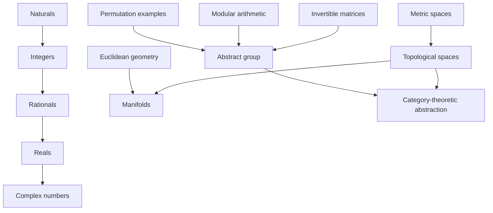

<!--
SPDX-FileCopyrightText: Copyright © 2026 Idiap Research Institute <contact@idiap.ch>

SPDX-FileContributor: Andre Freitas <andre.freitas@idiap.ch>
Neuro-symbolic AI Group

SPDX-FileContributor: Danilo Gusicuma <danilo.gusicuma@idiap.ch>
Neuro-symbolic AI Group

SPDX-License-Identifier: MIT
-->
# Dialectical Concept Solver: Refined Model with Mathematical Conceptual Evolution and Discovery

## 0. Purpose

This document refines a solver-implementable model of dialectical mathematical concept development. The earlier model treated conceptual evolution as a loop:

```text
concept -> determinate failure -> transformation -> successor concept -> proof obligations
```

This refinement adds two major capabilities:

1. **example-supported refinement**: historical and structural examples from mathematics are used to sharpen the formal failure types, transformation operators, and proof obligations;
2. **conceptual discovery**: the solver is allowed not only to repair a known concept, but also to invent useful new abstractions, equivalence notions, completions, universal objects, and organizing structures.

The goal is not to encode a vague philosophical metaphor. The goal is to make dialectical movement implementable as a typed, checkable, search-guided process over mathematical theories.

---

## 1. Refined core thesis

A mathematical concept should be represented as a structured theory with operations, axioms, examples, tasks, invariants, and protected meanings. Conceptual evolution occurs when the current representation is inadequate for its intended mathematical role.

The inadequacy may appear as:

- a failed proof obligation;
- a counterexample;
- a partial operation that wants to be total;
- a missing solution;
- a non-invariant representation;
- an overly rigid notion of identity;
- an inconsistent axiom scheme;
- an explosion of ad hoc cases;
- a recurring construction pattern lacking a name;
- a cluster of examples sharing an implicit structure.

Thus the solver must support both:

```text
repair-driven development
```

and

```text
discovery-driven development.
```

Repair-driven development starts from failure. Discovery-driven development starts from compression, invariance, analogy, transfer, or recurrent structure.

---

## 2. Refined formal object: Concept

A concept is not just a signature plus axioms. It also carries examples, intended uses, invariants, and a historical trace.

Let:

\[
C = (\Sigma, A, M, T, I, P, E, V, H, \Omega)
\]

where:

| Component | Meaning |
|---|---|
| \(\Sigma\) | typed signature: sorts, constants, functions, predicates, relations |
| \(A\) | axioms and definitional constraints |
| \(M\) | admissible models or semantic interpretations |
| \(T\) | intended tasks: prove, construct, classify, compute, decide, transfer |
| \(I\) | interface: operations exposed to downstream concepts |
| \(P\) | preservation constraints: facts or distinctions that must survive development |
| \(E\) | examples and counterexamples known to instantiate or challenge the concept |
| \(V\) | invariants, normal forms, equivalence notions, and representation maps |
| \(H\) | concept history: parent concepts, transformations, failure traces, proof certificates |
| \(\Omega\) | allowed meta-operators: quotient, completion, extension, abstraction, localization, etc. |

The extra fields \(E,V,H,\Omega\) are necessary for conceptual discovery. A solver cannot discover a new concept merely from an isolated failure; it needs examples, analogies, invariants, and transformation operators.

---

## 3. Task model

A task is a structured demand placed on a concept.

\[
\tau = (name, kind, context, goal, required\_status, priority)
\]

Possible task kinds:

| Task kind | Meaning | Example |
|---|---|---|
| `prove` | prove a proposition from the axioms | associativity of addition |
| `construct` | construct an object satisfying a specification | solve \(a-b=c\) |
| `compute` | evaluate a term or normal form | reduce a polynomial modulo an ideal |
| `decide` | decide membership, equality, equivalence, satisfiability | word problem in a group |
| `classify` | classify objects up to a chosen sameness relation | finite groups of order \(p\) |
| `transfer` | transport facts across representations | coordinate change for a linear map |
| `complete` | add missing limits, solutions, or closure | Cauchy completion |
| `abstract` | find minimal structure supporting a theorem | group abstraction from examples |
| `predict` | propose conjectures or new examples | infer a theorem schema from multiple models |

A task can fail, succeed, remain unknown, or produce a discovery signal.

\[
Eval(C,\tau) \in \{ Success, Failure(F), Unknown, DiscoverySignal(D) \}
\]

---

## 4. Failure certificates as determinate negations

A determinate negation is a typed certificate that the current concept fails in a specific way.

\[
F = (label, witness, failed\_obligation, trace, repair\_target, severity)
\]

where:

| Field | Meaning |
|---|---|
| `label` | failure type |
| `witness` | counterexample, unsat core, divergent sequence, missing solution, ambiguity witness |
| `failed_obligation` | the exact task or formula that failed |
| `trace` | dependency trace through axioms, definitions, and examples |
| `repair_target` | what kind of conceptual move would address the failure |
| `severity` | how central the failure is to the concept's intended role |

Canonical failure labels:

| Label | Solver meaning | Typical transformation |
|---|---|---|
| `NonClosure` | an operation exits the carrier | closure completion, extension |
| `NonSolvability` | an equation has no solution inside the concept | adjunction, algebraic extension |
| `Incompleteness` | limits, suprema, fixed points, or normal forms are missing | completion |
| `NonInvariance` | results depend on representation choices | quotient, invariant reformulation |
| `Rigidity` | equality or definition is too strict for intended classification | equivalence weakening |
| `Inconsistency` | axioms jointly entail contradiction | restriction, stratification, type refinement |
| `NonRepresentability` | current language cannot express needed objects or maps | abstraction, enrichment |
| `AmbiguousEquivalence` | sameness relation is underspecified or unstable | canonical equivalence relation |
| `NonCompositionality` | local constructions do not compose globally | categorical or sheaf-like reformulation |
| `CaseExplosion` | proofs require many accidental cases | abstraction, invariant, normal form |
| `NoUniversalProperty` | construction works but lacks canonical characterization | universal construction |
| `PoorTransfer` | theorems cannot be transported across examples | abstract interface discovery |

---

## 5. Discovery signals

Not all conceptual evolution begins with failure. Some new concepts arise because many separate constructions reveal a common pattern.

A discovery signal has the form:

\[
D = (label, evidence, latent\_structure, candidate\_move, score)
\]

Discovery labels:

| Label | Meaning | Example |
|---|---|---|
| `SharedInterface` | many examples support the same operations and laws | groups from permutations, modular addition, matrix multiplication |
| `InvariantPattern` | some property survives many transformations | topology from continuous deformation |
| `ProofCompression` | multiple proofs share a reusable skeleton | abstract algebraic theorem |
| `RepresentationRedundancy` | several presentations encode the same object | vector spaces replacing coordinate tuples |
| `EquivalencePressure` | classification ignores irrelevant internal differences | groups up to isomorphism |
| `UniversalPattern` | constructions repeatedly satisfy the same mapping property | products, quotients, free objects, completions |
| `FunctorialBehavior` | constructions preserve maps and composition | homology as a functor |
| `DualityPattern` | reversing arrows/operations yields parallel theorems | products vs coproducts |
| `ParameterGeneralization` | theorem holds for a parameterized family, not just instances | rings, fields, modules |
| `AnomalyCluster` | several failures share a common cause | need for completion or type stratification |

Discovery is crucial because it lets the solver propose concepts such as `Group`, `TopologicalSpace`, `VectorSpace`, `Category`, `Functor`, or `Manifold` even when no single contradiction forces them.

---

## 6. Development is a concept graph, not only a chain

The earlier model produced a linear chain:

```text
C0 -> C1 -> C2 -> ...
```

Conceptual discovery requires a graph:



The solver should maintain a directed labeled graph:

\[
G = (Nodes, Edges)
\]

where each node is a concept and each edge is a certified transformation, abstraction, embedding, quotient, completion, or analogy.

An edge has the form:

\[
C_i \xrightarrow{F/D,\Theta,certificates} C_j
\]

where the trigger may be either a failure \(F\) or a discovery signal \(D\).

---

## 7. Aufhebung as a verified transformation

A transformation \(\Theta(C,F)=C'\) counts as an implementable `Aufhebung` only if the solver can verify obligations.

\[
Aufhebung(C,F,C') \iff Preserve(C,C') \land Resolve(F,C') \land NonCollapse(C,C') \land Explain(C,F,C')
\]

### 7.1 Preservation

The old concept must survive in the new one by an embedding, interpretation, conservative extension, quotient map, or abstraction map.

\[
\iota : C \to C'
\]

Preservation obligation:

\[
\forall p \in P_C,\; C \models p \Rightarrow C' \models \iota(p)
\]

### 7.2 Resolution

The failure must be solved or relocated to a more precise boundary.

\[
Eval(C',\iota(\tau_F)) = Success
\]

or

\[
Eval(C',\iota(\tau_F)) = Failure(F') \quad\text{with}\quad rank(F') < rank(F)
\]

### 7.3 Non-collapse

The new concept must not trivialize the old one.

Examples:

- embedding is injective when injectivity is required;
- protected inequalities remain distinct;
- the new theory is consistent relative to accepted foundations;
- old theorems are not destroyed unless explicitly marked as representation-dependent.

### 7.4 Explanation

The transformation must give a usable trace:

```text
old concept C
failed or latent demand
constructive move Θ
new concept C'
preservation map
resolved task
new residual limits
```

This trace is essential for solver debugging and for human interpretability.

---

## 8. Discovery as constructive abstraction

A discovery move has a different shape from repair.

\[
Discover(\mathcal{E},D) = C^*
\]

where \(\mathcal{E}\) is a set of examples, models, proofs, tasks, or constructions, and \(D\) is a discovery signal.

The candidate discovered concept \(C^*\) must satisfy:

\[
DiscoveryValid(C^*) \iff Coverage \land Compression \land Transfer \land NonVacuity \land NovelUtility
\]

### 8.1 Coverage

The discovered concept must cover its motivating examples.

\[
\forall e \in \mathcal{E}_{target},\; e \models C^*
\]

Example: cyclic groups, permutation groups, and invertible matrices all instantiate `Group`.

### 8.2 Compression

The concept should reduce many similar facts to one theorem schema.

\[
Compression(C^*) = \frac{description\_length(examples + proofs)}{description\_length(C^* + instantiations + generic\_proofs)}
\]

A concept is useful when this ratio is greater than 1 by a meaningful margin.

### 8.3 Transfer

Theorems proved at the abstract level should transport to examples.

\[
C^* \vdash t \quad\Rightarrow\quad e \vdash instantiate(t,e)
\]

### 8.4 Non-vacuity

The concept should have nontrivial models and should not prove everything.

### 8.5 Novel utility

The concept should enable at least one of:

- new proofs;
- new classifications;
- new constructions;
- better normal forms;
- unification of examples;
- prediction of useful conjectures;
- fewer representation-dependent arguments.

---

## 9. Transformation and discovery operators

The solver needs an operator library. Operators are typed meta-level transformations.

| Operator | Input trigger | Output concept | Example |
|---|---|---|---|
| `AdjoinFormalInverse` | non-invertible operation | extended structure | \(\mathbb{N} \to \mathbb{Z}\) |
| `FieldOfFractions` | division not closed | fraction field/localization | \(\mathbb{Z} \to \mathbb{Q}\) |
| `Completion` | missing limits | complete space | \(\mathbb{Q} \to \mathbb{R}\) |
| `AlgebraicAdjunction` | missing root/solution | algebraic extension | \(\mathbb{R} \to \mathbb{C}\) |
| `QuotientByEquivalence` | redundant distinctions | quotient object | congruence classes, homotopy classes |
| `WeakenEquality` | strict identity too rigid | isomorphism/equivalence | groups up to isomorphism |
| `RestrictAxiomScheme` | inconsistency | safer theory | naive set theory to axiomatic set theory |
| `TypeStratify` | self-reference contradiction | typed hierarchy | simple type theory |
| `AbstractInterface` | shared laws across examples | structure class | group, ring, field, category |
| `Universalize` | repeated construction pattern | universal property | product, coproduct, free object |
| `Internalize` | meta-level operation recurs | object-level concept | maps as elements, functions as objects |
| `Categorify` | element-level reasoning inadequate | objects, morphisms, functors | functions to morphisms/functors |
| `Dualize` | parallel theorem under reversal | dual concept | product/coproduct, limit/colimit |
| `Sheafify` | local data fail to glue globally | sheaf/stack-like concept | local-to-global geometry |
| `Functorialize` | construction preserves maps | functorial concept | homology functor |
| `Invariantize` | representation dependence | coordinate-free form | tensors, manifolds |

---

## 10. Mathematical examples that refine the model

This section uses conceptual evolution examples to refine the solver model. Each example contributes a specific implementation lesson.

---

### 10.1 Number systems: closure, solvability, and completion

#### Development

\[
\mathbb{N} \to \mathbb{Z} \to \mathbb{Q} \to \mathbb{R} \to \mathbb{C}
\]

#### Solver interpretation

| Stage | Limitation | Failure certificate | Transformation | Successor |
|---|---|---|---|---|
| \(\mathbb{N}\) | subtraction not total | `NonClosure(sub, 3, 5)` | `AdjoinFormalInverse` / group completion | \(\mathbb{Z}\) |
| \(\mathbb{Z}\) | division not total | `NonClosure(div, 3, 5)` | `FieldOfFractions` | \(\mathbb{Q}\) |
| \(\mathbb{Q}\) | Cauchy limits missing | `Incompleteness(seq -> sqrt(2))` | `Completion` | \(\mathbb{R}\) |
| \(\mathbb{R}\) | polynomial roots missing | `NonSolvability(x^2+1=0)` | `AlgebraicAdjunction(i^2=-1)` | \(\mathbb{C}\) |

#### Refinement contributed by this example

This example shows that `NonClosure` is too coarse. The model should distinguish:

- operation closure failure;
- equation solvability failure;
- limit/completeness failure;
- algebraic closure failure.

It also shows that preservation maps differ by transformation type:

| Move | Preservation map |
|---|---|
| \(\mathbb{N}\to\mathbb{Z}\) | injective embedding |
| \(\mathbb{Z}\to\mathbb{Q}\) | localization/fraction embedding |
| \(\mathbb{Q}\to\mathbb{R}\) | dense order/metric embedding |
| \(\mathbb{R}\to\mathbb{C}\) | field embedding preserving real arithmetic |

#### Implementable trace

```json
{
  "from": "RationalField",
  "task": "all Cauchy sequences converge",
  "failure": {
    "label": "Incompleteness",
    "witness": "Cauchy sequence approximating sqrt(2)",
    "failed_obligation": "exists q: Rat, q*q = 2"
  },
  "operator": "MetricCompletion",
  "to": "RealField",
  "obligations": [
    "Rat embeds densely into Real",
    "field operations extend continuously",
    "every Cauchy sequence converges",
    "order is preserved"
  ],
  "new_residual_limits": [
    "not algebraically closed: x^2 + 1 has no real root"
  ]
}
```

---

### 10.2 Functions: formula, mapping, morphism, functor

#### Development

```text
formula -> set-theoretic function -> structure-preserving morphism -> functor -> natural transformation
```

#### Solver interpretation

The initial concept `FunctionAsFormula` fails because not every useful function is given by a simple expression.

Failure:

```text
NonRepresentability(function, no finite elementary formula)
```

The set-theoretic function repairs this by representing a function as a graph or total relation:

\[
f : X \to Y
\]

But a new limitation appears: arbitrary functions ignore structure. In algebra, topology, and geometry, the important maps preserve operations, open sets, smoothness, order, or composition.

This produces `Morphism`.

Then a further discovery signal appears: constructions themselves map whole structures to whole structures while preserving maps.

This produces `Functor`.

#### Refinement contributed by this example

The model needs `NonRepresentability` and `StructureLoss` as distinct from ordinary failure.

It also needs discovery from functorial behavior:

```text
if construction F maps objects to objects
and maps morphisms to morphisms
and preserves identity and composition,
then propose concept Functor.
```

#### Discovery rule

```text
DetectFunctoriality(construction K, category-like domain D, category-like codomain E):
    if for each object X in D, K(X) is object in E
    and for each morphism f: X -> Y, K(f): K(X) -> K(Y)
    and K(id_X) = id_K(X)
    and K(g ∘ f) = K(g) ∘ K(f):
        propose Functor(K, D, E)
```

---

### 10.3 Equality: identity, isomorphism, equivalence, homotopy equivalence

#### Development

```text
strict equality -> isomorphism -> equivalence -> homotopy equivalence -> equivalence as structure
```

#### Solver interpretation

Strict equality is often too rigid. Two groups may have different underlying sets but the same multiplication structure. Two vector spaces may use different bases but represent the same dimension and linear structure.

Failure:

```text
Rigidity(strict_equality, classification_task)
```

or:

```text
RepresentationRedundancy(two presentations, same invariant behavior)
```

Transformation:

```text
WeakenEquality(strict equality -> structure-preserving isomorphism)
```

#### Refinement contributed by this example

The model must separate:

- definitional equality;
- propositional equality;
- isomorphism;
- equivalence;
- weak equivalence;
- observational equivalence;
- equivalence generated by a task-specific invariant.

The solver should allow each concept to declare its classification relation:

```yaml
classification:
  relation: isomorphism
  invariant_targets:
    - operation_table_up_to_renaming
    - preserved_theorems
```

#### Obligation for weakening equality

When replacing equality by equivalence, prove:

1. equivalence is reflexive, symmetric, and transitive;
2. protected structure is preserved under equivalence;
3. classification tasks become stable;
4. the equivalence is not so coarse that all objects collapse.

---

### 10.4 Geometry: Euclidean space, non-Euclidean geometries, manifolds

#### Development

```text
Euclidean geometry -> non-Euclidean geometry -> manifolds -> coordinate-free differential geometry
```

#### Solver interpretation

Euclidean geometry initially treats one model of space as universal. The parallel postulate and curvature-sensitive phenomena reveal that the Euclidean model is not the only coherent geometry.

Failure or discovery signals:

```text
ModelPlurality(parallel_postulate)
NonInvariance(coordinate_dependent_formulas)
LocalGlobalTension(local Euclidean patches, global curved space)
```

Transformation:

```text
GeneralizeAxiom(parallel_postulate)
Localize(Euclidean patches -> manifold atlas)
Invariantize(coordinate formulas -> tensors/geometric objects)
```

#### Refinement contributed by this example

The solver must permit axiom variation, not only axiom addition. It must be able to say:

```text
An axiom formerly treated as necessary is actually a parameter in a family of theories.
```

This introduces `AxiomParameterization`:

\[
A = A_{common} \cup \{p\}
\]

becomes

\[
Family(A_{common}, parameter = p)
\]

#### Discovery rule

```text
DetectAxiomIndependenceOrModelPlurality(axiom p, base A):
    if model(A + p) exists
    and model(A + not p) exists:
        propose FamilyOfTheories(base=A, parameter=p)
```

---

### 10.5 Linear algebra: coordinates, vector spaces, linear maps, tensors

#### Development

```text
coordinate tuples and matrices -> vector spaces and linear maps -> basis-independent tensors
```

#### Solver interpretation

Matrices are effective but representation-dependent. A linear transformation changes matrix representation when the basis changes, while the underlying map remains the same.

Failure:

```text
NonInvariance(matrix_representation, basis_change)
```

Transformation:

```text
Invariantize(matrix -> linear map)
QuotientByChangeOfBasis(matrix presentations -> same transformation)
```

Further discovery:

```text
multilinear coordinate transformation laws recur -> propose Tensor
```

#### Refinement contributed by this example

The model needs a general pattern:

```text
representation object + transformation group + invariant content -> coordinate-free concept
```

Formal schema:

\[
C_{inv} = Rep / G
\]

where \(G\) is a group of representation changes, and the quotient preserves invariant structure.

#### Implementable operator

```text
Invariantize(C, action G on representations):
    define equivalence x ~ y iff exists g in G, y = g.x
    define invariant predicates P such that P(x) = P(g.x)
    construct quotient or coordinate-free object
    prove operations are well-defined on equivalence classes
```

---

### 10.6 Abstract algebra: discovering groups from examples

#### Motivating examples

- integers under addition;
- nonzero rationals under multiplication;
- permutations under composition;
- invertible matrices under multiplication;
- symmetries of a polygon.

These examples were not created by repairing one failed theory. They reveal a shared interface.

#### Discovery signal

```text
SharedInterface(
  examples = [Z_add, Q_nonzero_mul, permutations, invertible_matrices, polygon_symmetries],
  operations = [binary operation, identity, inverse],
  laws = [associativity, identity laws, inverse laws]
)
```

#### Discovered concept

```text
Group = structure with carrier G, operation *, identity e, inverse inv, and group laws.
```

#### Refinement contributed by this example

This is the central example for conceptual discovery. It shows that the solver must perform **anti-unification** across examples:

```text
specific operation + specific identity + specific inverse
```

becomes

```text
generic binary operation + generic identity + generic inverse.
```

#### Discovery algorithm sketch

```text
DiscoverAbstractInterface(examples):
    signatures := extract_operations_and_laws(examples)
    common_core := anti_unify(signatures)
    candidate_axioms := infer_shared_laws(common_core, examples)
    C* := build_concept(common_core, candidate_axioms)
    obligations := [
        every motivating example instantiates C*,
        generic theorems transfer to examples,
        C* has nontrivial models,
        C* is not overfit to the examples
    ]
    return C*
```

#### Machine-readable discovered concept

```yaml
concept: Group
kind: discovered_abstraction
trigger:
  label: SharedInterface
  examples:
    - IntegersUnderAddition
    - NonzeroRationalsUnderMultiplication
    - PermutationGroup
    - GeneralLinearGroup
signature:
  sorts:
    - G
  operations:
    mul: G x G -> G
    id: G
    inv: G -> G
axioms:
  - forall a b c: G, mul(mul(a,b),c) = mul(a,mul(b,c))
  - forall a: G, mul(id,a) = a
  - forall a: G, mul(a,id) = a
  - forall a: G, mul(inv(a),a) = id
  - forall a: G, mul(a,inv(a)) = id
obligations:
  coverage:
    - IntegersUnderAddition instantiates Group
    - NonzeroRationalsUnderMultiplication instantiates Group
    - PermutationGroup instantiates Group
  non_vacuity:
    - exists nontrivial finite group
  transfer:
    - theorem uniqueness_of_identity transfers to all instances
    - theorem cancellation transfers to all instances
```

---

### 10.7 Rings, fields, and modules: parameterized abstraction

#### Development

```text
integers, polynomials, matrices -> rings
rational, real, complex numbers -> fields
vector spaces over fields -> modules over rings
```

#### Solver interpretation

The concept `VectorSpace` is powerful but too restrictive when scalars come from a ring instead of a field. Theorems split into those that require division and those that do not.

Failure:

```text
OverstrongAxiom(field_inverse, theorem_does_not_need_it)
```

Discovery signal:

```text
ProofCompression(theorems use only ring axioms, not field axioms)
```

Transformation:

```text
WeakenScalarStructure(Field -> Ring)
AbstractInterface(VectorSpace -> Module)
```

#### Refinement contributed by this example

The solver should track axiom dependency of proofs. If many results do not use the full structure, propose a weaker abstraction.

Discovery rule:

```text
AxiomDependencyGeneralization(theorem t, proof π, concept C):
    deps := minimal_axiom_dependencies(π)
    if deps are strictly weaker than C.axioms:
        propose weaker concept C_min supporting t
```

---

### 10.8 Topology: from metric spaces to open-set structure

#### Development

```text
metric spaces -> topological spaces -> continuous maps -> homeomorphism
```

#### Solver interpretation

Metric spaces encode distance. But many properties of continuity, convergence, and deformation do not depend on the exact metric. Different metrics can determine the same open sets.

Failure/discovery signal:

```text
RepresentationRedundancy(distances differ, open-set behavior same)
InvariantPattern(continuity depends only on opens)
```

Transformation:

```text
AbstractInterface(metric -> topology)
```

#### Refinement contributed by this example

The model needs invariant extraction:

```text
Find minimal data needed to preserve a target class of theorems.
```

For continuity, the solver can detect:

```text
proofs use preimages of open sets, not numerical distances.
```

Candidate concept:

```yaml
concept: TopologicalSpace
signature:
  sorts:
    - X
  predicates:
    Open: Set(X) -> Prop
axioms:
  - Open(empty)
  - Open(X)
  - arbitrary_unions_of_open_sets_are_open
  - finite_intersections_of_open_sets_are_open
classification:
  sameness: homeomorphism
```

---

### 10.9 Set theory: naive comprehension to axiomatic or typed foundations

#### Development

```text
naive set comprehension -> contradiction -> axiomatic set theory / type theory
```

#### Solver interpretation

Naive comprehension permits a set of all sets not containing themselves, producing contradiction.

Failure:

```text
Inconsistency(naive_comprehension, Russell_witness)
```

Transformation options:

```text
RestrictAxiomScheme -> axiomatic set theory
TypeStratify -> type theory
ClassSetDistinction -> class theory
```

#### Refinement contributed by this example

Some failures cannot be solved by extension. They require restriction or stratification.

The model must not assume that development always means adding objects. Sometimes it means:

- removing an unsafe axiom;
- indexing types by levels;
- distinguishing sets from proper classes;
- replacing unrestricted construction with guarded construction.

#### Obligation type added

```text
ConsistencyRecovery(C, C'):
    C' blocks the contradiction witness
    C' preserves safe fragments of C
    C' supports intended set-building tasks under restrictions
```

---

### 10.10 Calculus: infinitesimal intuition, epsilon-delta rigor, smooth structure

#### Development

```text
informal infinitesimals -> limits -> metric/topological definitions -> smooth manifolds
```

#### Solver interpretation

Early infinitesimal reasoning is computationally powerful but may lack precise foundations. Epsilon-delta limits repair rigor. Later, smooth structures and manifolds abstract differentiability away from global coordinates.

Failure/discovery signals:

```text
AmbiguousInfinitesimal
NeedForLimitDefinition
CoordinateDependence(derivatives on curved spaces)
```

Transformations:

```text
DefineLimit(epsilon_delta)
Topologize(continuity)
Localize(smooth charts)
Invariantize(differential forms, tangent spaces)
```

#### Refinement contributed by this example

A concept can split into multiple rigorous descendants:

```text
infinitesimal intuition -> epsilon-delta analysis
                         -> nonstandard analysis
                         -> synthetic differential geometry
```

So the concept graph must allow branching descendants, not a single canonical successor.

---

### 10.11 Algebraic topology: detecting holes by functorial invariants

#### Development

```text
geometric spaces -> deformation equivalence -> homotopy/homology invariants -> functorial algebraic shadows
```

#### Solver interpretation

Geometric spaces may not be classifiable by pointwise equality or simple geometric shape. The relevant properties are preserved under continuous deformation.

Failure:

```text
Rigidity(strict_homeomorphism_for_some_tasks)
NonRepresentability(holes not captured by elementary coordinates)
```

Discovery signal:

```text
FunctorialBehavior(space maps -> group homomorphisms)
InvariantPattern(deformation preserves homology groups)
```

Transformation:

```text
ConstructInvariantFunctor(TopologicalSpace -> AlgebraicStructure)
```

#### Refinement contributed by this example

The model needs the concept of an **invariant-valued abstraction**:

\[
F : \mathcal{C} \to \mathcal{D}
\]

where \(F\) maps complex objects into more computable structures while preserving relevant maps.

Obligations:

1. invariant is well-defined;
2. invariant respects equivalence;
3. invariant is functorial;
4. invariant separates examples when possible;
5. failure to separate is reported, not hidden.

---

### 10.12 Category theory: discovering structure of structure

#### Development

```text
sets and functions, groups and homomorphisms, spaces and continuous maps -> categories
categories and structure-preserving maps -> functors
functors and coherent comparison maps -> natural transformations
```

#### Solver interpretation

The same pattern appears in many domains:

- objects;
- structure-preserving arrows;
- identity arrows;
- associative composition.

Discovery signal:

```text
SharedInterfaceAcrossTheories(object, morphism, identity, composition)
```

Discovered concept:

```text
Category
```

Further discovery:

```text
structure-preserving maps between categories -> Functor
maps between functors -> NaturalTransformation
```

#### Refinement contributed by this example

The solver needs higher-order abstraction. It should be able to abstract not only from objects, but from whole theories and their maps.

This adds the operator:

```text
Categorify(level n concept -> level n+1 concept)
```

Example:

```text
elements -> objects
functions -> morphisms
properties -> universal properties
equalities -> natural isomorphisms
sets of things -> categories of things
```

---

## 11. Refined failure taxonomy from the examples

The examples suggest a more precise taxonomy:

| Class | Failure label | Example | Preferred operator |
|---|---|---|---|
| Algebraic closure | `OperationNonClosure` | \(3-5\notin\mathbb{N}\) | group completion |
| Algebraic solvability | `EquationNonSolvability` | \(x^2+1=0\) over \(\mathbb{R}\) | algebraic adjunction |
| Analytic completeness | `LimitIncompleteness` | Cauchy sequence in \(\mathbb{Q}\) | completion |
| Representational | `CoordinateDependence` | matrices under basis change | invariantization |
| Classification | `Rigidity` | equality too strict for groups | isomorphism/equivalence |
| Foundational | `Inconsistency` | naive comprehension | restriction/stratification |
| Abstraction | `PoorTransfer` | repeated theorem proofs in examples | abstract interface |
| Structural | `NonCompositionality` | local data fail to glue | sheafification |
| Expressive | `NonRepresentability` | formula-only functions | broader function concept |
| Search-theoretic | `CaseExplosion` | too many special proofs | invariant or normal form |
| Meta-mathematical | `OverstrongAxiom` | proof uses ring axioms, not field axioms | weaken abstraction |
| Higher-order | `MissingCoherence` | maps between functors need comparison | natural transformation |

---

## 12. Refined proof obligations

A candidate successor concept should carry explicit obligations. Not every transformation needs all obligations, but each candidate should declare which ones apply.

### 12.1 Preservation obligations

```text
old concepts embed, interpret, quotient, or instantiate in the new concept.
```

Examples:

- \(\mathbb{N}\hookrightarrow\mathbb{Z}\);
- rational numbers embed densely in real numbers;
- matrices modulo basis change correspond to linear maps;
- metric spaces instantiate topological spaces.

### 12.2 Resolution obligations

```text
the motivating failure is repaired.
```

Examples:

- subtraction becomes total in \(\mathbb{Z}\);
- Cauchy sequences converge in \(\mathbb{R}\);
- coordinate-dependent formulas are replaced by invariant objects.

### 12.3 Non-collapse obligations

```text
protected distinctions survive.
```

Examples:

- \(0\neq1\) remains true;
- the embedding \(\mathbb{N}\to\mathbb{Z}\) is injective;
- quotient by isomorphism does not identify all groups;
- topological abstraction does not collapse all spaces into one.

### 12.4 Conservativity obligations

```text
new concept does not alter old truths in protected language.
```

This is especially important for foundational moves.

### 12.5 Universality obligations

For universal constructions, prove the relevant universal property.

Examples:

- \(\mathbb{Z}\) is the group completion of \(\mathbb{N}\);
- \(\mathbb{Q}\) is the field of fractions of \(\mathbb{Z}\);
- product objects satisfy the product universal property;
- quotient objects satisfy the quotient universal property.

### 12.6 Transfer obligations

For discovered abstractions, prove that generic theorems transfer to examples.

```text
if Group proves cancellation,
then IntegersUnderAddition, Permutations, and GeneralLinearGroup inherit cancellation.
```

### 12.7 Adequacy obligations

For abstraction, prove that the abstraction captures the target tasks.

Example:

```text
TopologicalSpace is adequate for continuity arguments that use only open-set behavior.
```

### 12.8 Residual-limit reporting

Every successor concept should report what it still cannot do.

Examples:

- \(\mathbb{R}\) fixes metric completeness but is not algebraically closed;
- \(\mathbb{C}\) fixes many polynomial solvability tasks but cannot preserve order-field structure;
- topological spaces abstract continuity but forget metric distance;
- groups capture invertible composition but not addition/multiplication interaction.

This keeps the solver from treating a successor concept as final.

---

## 13. Candidate ranking

A candidate concept \(C'\) should be ranked by a multi-objective score:

\[
Score(C') =
\alpha R + \beta P + \gamma K + \delta U + \epsilon T + \zeta N - \lambda Cost - \mu Loss
\]

where:

| Term | Meaning |
|---|---|
| \(R\) | resolution of known failures |
| \(P\) | preservation of protected old structure |
| \(K\) | compression of examples/proofs |
| \(U\) | universality/canonicality |
| \(T\) | transfer power across examples |
| \(N\) | novelty or discovery utility |
| `Cost` | complexity of new axioms, objects, or proof burden |
| `Loss` | lost structure or weakened tasks |

This is important because multiple successors may be valid.

Example:

```text
naive infinitesimal calculus
  -> epsilon-delta analysis
  -> nonstandard analysis
  -> synthetic differential geometry
```

Each successor optimizes different goals. The solver should branch or maintain a Pareto frontier, not force a single winner.

---

## 14. Branching solver architecture

Instead of returning one chain, the solver maintains a concept graph and frontier.

```text
Input:
    seed concepts C0
    tasks T
    examples E
    transformation library Ω
    discovery budget B

Output:
    concept graph G with certified edges and ranked discoveries
```

### 14.1 Main loop

```text
G := initialize_graph(seed_concepts)
Frontier := seed_concepts

while resource_budget_available:
    C := select_frontier_node(Frontier)

    failures := EvaluateTasks(C)
    discovery_signals := DetectDiscoverySignals(C, G)

    repair_candidates := []
    for F in failures:
        for Θ in applicable_repair_operators(F, C.Ω):
            C_candidate := Θ(C, F)
            obligations := GenerateRepairObligations(C, F, C_candidate)
            repair_candidates.append((C_candidate, obligations, trigger=F))

    discovery_candidates := []
    for D in discovery_signals:
        for Λ in applicable_discovery_operators(D, C.Ω):
            C_candidate := Λ(G, D)
            obligations := GenerateDiscoveryObligations(G, D, C_candidate)
            discovery_candidates.append((C_candidate, obligations, trigger=D))

    candidates := repair_candidates + discovery_candidates

    for candidate in candidates:
        proof_status := TryProveObligations(candidate.obligations)
        score := Rank(candidate, proof_status)
        if Accept(candidate, proof_status, score):
            AddNodeAndCertifiedEdge(G, C, candidate)
            Frontier.add(candidate.C_candidate)

return G
```

### 14.2 Solver backends

A realistic implementation can use multiple engines:

| Backend | Role |
|---|---|
| SMT solver | finite first-order obligations, counterexamples, consistency checks in bounded domains |
| model finder | small model discovery and independence witnesses |
| theorem prover | certified preservation and universal properties |
| term rewriting / e-graphs | equivalence saturation, representation normalization |
| CAS | algebraic computation, polynomial examples, field extensions |
| graph search | concept graph expansion and ranking |
| anti-unification engine | abstraction from examples and proof schemas |
| type checker | stratification, interface validity, dependent typing |

---

## 15. Data schemas

### 15.1 Concept node

```json
{
  "id": "ConceptID",
  "name": "TopologicalSpace",
  "signature": {
    "sorts": ["X"],
    "operations": {},
    "predicates": {
      "Open": "Set(X) -> Prop"
    }
  },
  "axioms": [
    "Open(empty)",
    "Open(X)",
    "arbitrary_unions_open",
    "finite_intersections_open"
  ],
  "tasks": [
    {
      "name": "define_continuity",
      "kind": "abstract",
      "goal": "continuity using preimages of open sets"
    }
  ],
  "examples": ["MetricSpaceInducedTopology", "DiscreteTopology", "IndiscreteTopology"],
  "invariants": ["homeomorphism", "open_set_lattice"],
  "preserve": ["set_carrier", "continuity_theorems_using_opens"],
  "history": []
}
```

### 15.2 Failure certificate

```json
{
  "label": "CoordinateDependence",
  "witness": {
    "object": "matrix representation of linear map",
    "change": "basis transformation P",
    "before": "A",
    "after": "P^{-1} A P"
  },
  "failed_obligation": "classification independent of basis",
  "trace": ["matrix_representation", "basis_choice", "similarity_transform"],
  "repair_target": "Invariantize",
  "severity": 0.91
}
```

### 15.3 Discovery signal

```json
{
  "label": "SharedInterface",
  "evidence": [
    "IntegersUnderAddition",
    "PermutationGroup",
    "GeneralLinearGroup",
    "PolygonSymmetryGroup"
  ],
  "latent_structure": {
    "operation": "binary associative operation",
    "identity": "neutral element",
    "inverse": "two-sided inverse"
  },
  "candidate_move": "AbstractInterface",
  "score": 0.94
}
```

### 15.4 Transformation edge

```json
{
  "from": "MetricSpace",
  "to": "TopologicalSpace",
  "trigger": {
    "type": "DiscoverySignal",
    "label": "InvariantPattern"
  },
  "operator": "AbstractInterface",
  "map": {
    "kind": "forgetful",
    "definition": "metric d induces opens by epsilon balls"
  },
  "obligations": [
    {
      "name": "metric_induces_topology",
      "status": "proved"
    },
    {
      "name": "metric_continuity_implies_topological_continuity",
      "status": "proved"
    },
    {
      "name": "open_set_axioms_hold",
      "status": "proved"
    }
  ],
  "residual_losses": [
    "distance magnitude forgotten",
    "not all topologies are metrizable"
  ]
}
```

---

## 16. Operator specifications

### 16.1 Group completion

```yaml
operator: GroupCompletion
applicable_when:
  failure_label: OperationNonClosure
  structure: commutative_monoid
  missing_operation: additive_inverse
input:
  concept: C
  operation: add
output:
  concept: GrothendieckGroup(C)
obligations:
  - C embeds into GrothendieckGroup(C) under cancellativity assumptions
  - add is preserved
  - additive inverses exist
  - universal_property: maps from C to any abelian group factor uniquely
residual_limits:
  - multiplication or division not automatically supplied
```

### 16.2 Field of fractions / localization

```yaml
operator: FieldOfFractions
applicable_when:
  concept_has: integral_domain
  failure_label: OperationNonClosure
  missing_operation: division_by_nonzero
output:
  concept: Frac(R)
obligations:
  - R embeds into Frac(R)
  - every nonzero element of R becomes invertible
  - field axioms hold
  - universal_property: homomorphisms from R to fields factor through Frac(R)
```

### 16.3 Completion

```yaml
operator: Completion
applicable_when:
  failure_label: LimitIncompleteness
  concept_has: metric_or_uniform_structure
output:
  concept: Complete(C)
obligations:
  - C embeds densely into Complete(C)
  - Cauchy sequences/nets converge in Complete(C)
  - operations extend continuously when applicable
  - universal_property: maps into complete spaces extend when conditions hold
residual_limits:
  - may forget computability or algebraic decidability
```

### 16.4 Algebraic adjunction

```yaml
operator: AlgebraicAdjunction
applicable_when:
  failure_label: EquationNonSolvability
  equation: polynomial_or_algebraic_spec
output:
  concept: C[alpha] / relation(equation(alpha))
obligations:
  - original concept embeds into extension
  - adjoined element satisfies equation
  - operations are well-defined modulo relation
  - noncollapse: relation does not force 0 = 1
```

### 16.5 Abstract interface discovery

```yaml
operator: AbstractInterface
applicable_when:
  discovery_label: SharedInterface
input:
  examples: list[ConceptOrModel]
  theorem_traces: optional list[Proof]
output:
  concept: AbstractStructure
obligations:
  - coverage: examples instantiate abstraction
  - minimality: axioms are not stronger than needed for target theorems
  - transfer: generic theorems instantiate in examples
  - non_vacuity: abstraction has nontrivial models
  - novelty: abstraction reduces proof duplication
```

### 16.6 Invariantization

```yaml
operator: Invariantize
applicable_when:
  failure_label: CoordinateDependence
input:
  representation_space: Rep
  transformation_group_or_groupoid: G
output:
  concept: InvariantObject
obligations:
  - define equivalence relation from G-action
  - operations are well-defined on equivalence classes
  - target invariants are constant on equivalence classes
  - protected distinctions are preserved when invariantly meaningful
```

### 16.7 Axiom weakening

```yaml
operator: WeakenAxioms
applicable_when:
  discovery_label: ProofCompression
  proof_dependencies: strict_subset_of_current_axioms
output:
  concept: MinimalSupportingStructure
obligations:
  - target theorems provable from weaker axioms
  - motivating examples instantiate weaker structure
  - old concept maps to weaker concept by forgetful functor/interface reduction
```

### 16.8 Stratification

```yaml
operator: TypeStratify
applicable_when:
  failure_label: Inconsistency
  cause: self_reference_or_unrestricted_comprehension
output:
  concept: StratifiedTheory
obligations:
  - contradiction witness is blocked
  - safe constructions preserved
  - type levels are respected by all definitions
  - consistency relative to accepted base, when available
```

---

## 17. Discovery mechanisms

### 17.1 Anti-unification across examples

Anti-unification finds a least general generalization of terms, operations, or proof patterns.

Example:

```text
integer addition:       (Z, +, 0, -)
permutation composition: (Sym(X), ∘, id, inverse)
matrix multiplication:   (GL(n), *, I, inverse)
```

Common abstraction:

```text
(G, op, e, inv)
```

with laws:

```text
associativity, identity, inverse
```

### 17.2 Axiom dependency minimization

Given a proof in a rich concept, find the minimal axioms actually used.

```text
if theorem about vector spaces does not use scalar inverses,
then propose module-level theorem.
```

This supports discovery of weaker concepts.

### 17.3 Invariant extraction

Given a representation family and transformation group, find predicates stable under transformations.

```text
matrix A and P^{-1}AP represent the same linear operator under basis change.
```

The solver proposes invariant objects and quotients.

### 17.4 Universal property detection

Given repeated constructions with maps into or out of them, identify a universal mapping pattern.

Examples:

```text
product: maps into A×B correspond to pairs of maps into A and into B
quotient: maps out of X/~ correspond to maps out of X constant on equivalence classes
free group: maps from generators into any group extend uniquely
```

### 17.5 Functoriality detection

Given a construction on objects, test whether it also acts on maps and respects identity/composition.

```text
space X -> homology group H_n(X)
continuous map f -> group homomorphism H_n(f)
```

This turns a construction into a functor.

### 17.6 Dualization

Given a theory expressed in arrows, reverse arrows and search for valid dual theorems.

Examples:

```text
monomorphism <-> epimorphism
product <-> coproduct
limit <-> colimit
initial object <-> terminal object
```

### 17.7 Residual-limit mining

After a successful transformation, search for remaining failures. These become seeds for future development.

Example:

```text
Q -> R resolves metric incompleteness.
Then solver tests polynomial solvability and finds x^2 + 1 = 0 unresolved.
This seeds R -> C.
```

---

## 18. Conceptual discovery scoring

Discovery candidates should not be accepted merely because they are definable. They should be useful.

\[
DiscoveryScore(C^*) =
\alpha Coverage + \beta Compression + \gamma Transfer + \delta PredictivePower
+ \epsilon Canonicality - \lambda Complexity - \mu Overfit
\]

### 18.1 Coverage

How many motivating examples instantiate the concept?

### 18.2 Compression

How many separate proofs/constructions become instances of one abstract proof/construction?

### 18.3 Transfer

How many theorems can be transported across instances?

### 18.4 Predictive power

Does the abstraction suggest new valid examples, counterexamples, or theorem schemas?

### 18.5 Canonicality

Does the construction satisfy a universal property or naturality condition?

### 18.6 Complexity

How expensive are the new definitions, axioms, and proof obligations?

### 18.7 Overfit penalty

Does the concept merely encode the examples, or does it generalize?

---

## 19. Worked discovery trace: from examples to `Group`

### 19.1 Input examples

```json
[
  {
    "name": "IntegersUnderAddition",
    "carrier": "Z",
    "operation": "+",
    "identity": "0",
    "inverse": "negation"
  },
  {
    "name": "PermutationGroup",
    "carrier": "Sym(X)",
    "operation": "composition",
    "identity": "identity permutation",
    "inverse": "inverse permutation"
  },
  {
    "name": "GeneralLinearGroup",
    "carrier": "invertible matrices",
    "operation": "matrix multiplication",
    "identity": "identity matrix",
    "inverse": "matrix inverse"
  }
]
```

### 19.2 Discovery signal

```json
{
  "label": "SharedInterface",
  "latent_structure": [
    "carrier",
    "binary operation",
    "identity",
    "inverse",
    "associativity",
    "identity laws",
    "inverse laws"
  ],
  "candidate_move": "AbstractInterface"
}
```

### 19.3 Proposed concept

```text
Group(G, *, e, inv)
```

### 19.4 Proof obligations

```text
1. IntegersUnderAddition instantiates Group.
2. PermutationGroup instantiates Group.
3. GeneralLinearGroup instantiates Group.
4. Group has nontrivial models.
5. Generic cancellation theorem is provable from group axioms.
6. Generic cancellation theorem transfers to all examples.
7. Axioms are not overfit to the specific examples.
```

### 19.5 Output edge

```json
{
  "from": ["IntegersUnderAddition", "PermutationGroup", "GeneralLinearGroup"],
  "to": "Group",
  "trigger": "SharedInterface",
  "operator": "AbstractInterface",
  "status": "accepted",
  "certificates": {
    "coverage": "proved",
    "non_vacuity": "proved",
    "transfer": "proved_for_cancellation",
    "compression": "positive"
  }
}
```

---

## 20. Worked repair trace: from `Naturals` to `Integers`

### 20.1 Initial concept

```yaml
concept: Naturals
signature:
  sorts: [Nat]
  operations:
    zero: Nat
    succ: Nat -> Nat
    add: Nat x Nat -> Nat
    sub: Nat x Nat -> Nat?
axioms:
  - PeanoAxioms
  - addition_recursion
intended_tasks:
  - name: total_subtraction
    kind: construct
    goal: forall a b: Nat, exists c: Nat, c = a - b
preserve:
  - zero_distinct_from_successor
  - addition_associative
  - addition_commutative
  - order_embedding
```

### 20.2 Failure

```json
{
  "label": "OperationNonClosure",
  "operation": "sub",
  "witness": [3, 5],
  "failed_obligation": "exists c: Nat, c = 3 - 5",
  "repair_target": "AdjoinFormalInverse"
}
```

### 20.3 Candidate successor

```yaml
concept: Integers
constructed_by: GroupCompletion(NaturalsUnderAddition)
embedding:
  from: Nat
  to: Int
  map: n -> [(n,0)]
signature:
  sorts: [Int]
  operations:
    zero: Int
    add: Int x Int -> Int
    neg: Int -> Int
    sub: Int x Int -> Int
axioms:
  - abelian_group_under_addition
  - nat_embedding_preserves_addition
```

### 20.4 Obligations

```text
1. Nat embeds into Int.
2. Nat addition is preserved.
3. Int subtraction is total.
4. Nat order is preserved on the embedded image.
5. Non-collapse: distinct natural numbers remain distinct in Int.
6. Universal property: Int is initial among abelian groups receiving a monoid map from Nat.
```

---

## 21. Worked invariantization trace: matrices to linear maps

### 21.1 Failure

```json
{
  "label": "CoordinateDependence",
  "witness": {
    "matrix_A": "A",
    "basis_change": "P",
    "transformed_matrix": "P^{-1} A P"
  },
  "failed_obligation": "classification of linear transformation independent of basis",
  "repair_target": "Invariantize"
}
```

### 21.2 Transformation

```text
MatrixRepresentation / change-of-basis equivalence -> LinearMap
```

### 21.3 Obligations

```text
1. Equivalent matrices define the same abstract linear transformation.
2. Every linear transformation has a matrix representation after a basis is chosen.
3. Composition of linear maps corresponds to matrix multiplication under compatible bases.
4. Invariants such as trace, determinant, rank, and eigenvalues where defined are basis-independent.
5. Not all matrix entries are preserved; entry-level data are representation artifacts.
```

### 21.4 Refinement

This introduces a reusable solver pattern:

```text
Representation + transformation groupoid -> invariant object
```

The transformation groupoid may be more general than a group because changes of chart, coordinate system, basis, or local trivialization may only compose when domains match.

---

## 22. Worked abstraction trace: metric spaces to topological spaces

### 22.1 Discovery signal

```json
{
  "label": "InvariantPattern",
  "evidence": [
    "continuity proofs use open balls only through open sets",
    "different metrics can induce the same open sets",
    "homeomorphism ignores exact distances"
  ],
  "latent_structure": "open-set system",
  "candidate_move": "AbstractInterface"
}
```

### 22.2 Candidate concept

```yaml
concept: TopologicalSpace
signature:
  sorts: [X]
  predicates:
    Open: Set(X) -> Prop
axioms:
  - Open(empty)
  - Open(X)
  - arbitrary_unions_of_open_sets_are_open
  - finite_intersections_of_open_sets_are_open
```

### 22.3 Obligations

```text
1. Every metric space induces a topology.
2. Metric continuity implies topological continuity.
3. Topological continuity specializes to metric continuity for metric-induced topologies.
4. Homeomorphism preserves topological properties.
5. Distance-specific properties are intentionally not preserved.
```

---

## 23. Worked foundational repair: naive sets to stratified theory

### 23.1 Failure

```json
{
  "label": "Inconsistency",
  "witness": "R = {x | x notin x}",
  "failed_obligation": "consistent comprehension",
  "trace": ["unrestricted_comprehension", "self_membership"],
  "repair_target": "RestrictAxiomScheme or TypeStratify"
}
```

### 23.2 Candidate successors

```text
A. restricted axiomatic set theory
B. type-stratified theory
C. class/set distinction
```

### 23.3 Obligations

```text
1. The Russell witness is no longer constructible.
2. Standard safe constructions remain possible.
3. The new theory supports ordinary mathematics.
4. The new theory is consistent relative to an accepted base, if available.
5. The repair is explicit about which comprehension principles are forbidden.
```

### 23.4 Refinement

This example prevents a naive implementation mistake: not every failure should be repaired by adding new objects. Some failures require subtractive transformation.

Dialectical transformation therefore includes:

```text
extension, quotient, completion, abstraction, restriction, stratification.
```

---

## 24. Minimal implementation plan

A practical prototype can be staged.

### Stage 1: typed concept registry

Implement:

```text
Concept
Task
FailureCertificate
DiscoverySignal
TransformationOperator
ProofObligation
ConceptGraph
```

### Stage 2: finite-model and SMT evaluation

Support bounded examples:

- finite monoids;
- finite groups;
- small rings;
- finite graphs;
- finite topological spaces;
- small categories.

Use these to generate counterexamples and discovery signals.

### Stage 3: transformation library

Implement initial operators:

```text
AdjoinFormalInverse
QuotientByEquivalence
AbstractInterface
WeakenEquality
Invariantize
RestrictAxiomScheme
CompletionStub
Universalize
```

`CompletionStub` may initially generate obligations without fully constructing analytic completions.

### Stage 4: theorem-prover integration

Export obligations to Lean, Coq, Isabelle, or another prover.

Example obligation:

```text
prove that Nat -> Int embedding preserves addition.
```

### Stage 5: concept discovery loop

Add:

```text
anti-unification of signatures
axiom dependency minimization
invariant extraction
functoriality detection
universal property detection
branching graph search
```

---

## 25. Pseudocode for discovery-aware solver

```python
class Concept:
    def __init__(self, name, signature, axioms, tasks, examples, invariants, preserve, history):
        self.name = name
        self.signature = signature
        self.axioms = axioms
        self.tasks = tasks
        self.examples = examples
        self.invariants = invariants
        self.preserve = preserve
        self.history = history

class FailureCertificate:
    def __init__(self, label, witness, obligation, trace, repair_target, severity):
        self.label = label
        self.witness = witness
        self.obligation = obligation
        self.trace = trace
        self.repair_target = repair_target
        self.severity = severity

class DiscoverySignal:
    def __init__(self, label, evidence, latent_structure, candidate_move, score):
        self.label = label
        self.evidence = evidence
        self.latent_structure = latent_structure
        self.candidate_move = candidate_move
        self.score = score


def develop_concepts(seed_graph, budget):
    graph = seed_graph
    frontier = list(seed_graph.nodes)

    while budget.remaining():
        C = select_concept(frontier, graph)

        failures = evaluate_tasks(C)
        signals = detect_discovery_signals(C, graph)

        candidates = []

        for F in failures:
            for op in applicable_repair_ops(C, F):
                C2 = op.apply(C, F)
                obligations = generate_repair_obligations(C, F, C2)
                candidates.append((C2, op, F, obligations))

        for D in signals:
            for op in applicable_discovery_ops(graph, D):
                C2 = op.discover(graph, D)
                obligations = generate_discovery_obligations(graph, D, C2)
                candidates.append((C2, op, D, obligations))

        for C2, op, trigger, obligations in candidates:
            certificates = prove_or_estimate(obligations)
            score = rank_candidate(C2, trigger, certificates, graph)

            if acceptable(score, certificates):
                graph.add_node(C2)
                graph.add_edge(
                    source=C,
                    target=C2,
                    operator=op.name,
                    trigger=trigger,
                    certificates=certificates,
                    score=score,
                )
                frontier.append(C2)

    return graph
```

---

## 26. Example solver output: concept graph fragment

```json
{
  "nodes": [
    "Naturals",
    "Integers",
    "Rationals",
    "Reals",
    "ComplexNumbers",
    "PermutationExamples",
    "MatrixExamples",
    "Group",
    "MetricSpace",
    "TopologicalSpace",
    "Category"
  ],
  "edges": [
    {
      "from": "Naturals",
      "to": "Integers",
      "operator": "GroupCompletion",
      "trigger": "OperationNonClosure",
      "status": "certified"
    },
    {
      "from": "Integers",
      "to": "Rationals",
      "operator": "FieldOfFractions",
      "trigger": "DivisionNonClosure",
      "status": "certified"
    },
    {
      "from": "Rationals",
      "to": "Reals",
      "operator": "Completion",
      "trigger": "LimitIncompleteness",
      "status": "partially_certified"
    },
    {
      "from": "Reals",
      "to": "ComplexNumbers",
      "operator": "AlgebraicAdjunction",
      "trigger": "EquationNonSolvability",
      "status": "certified"
    },
    {
      "from": ["PermutationExamples", "MatrixExamples", "Integers"],
      "to": "Group",
      "operator": "AbstractInterface",
      "trigger": "SharedInterface",
      "status": "discovered"
    },
    {
      "from": "MetricSpace",
      "to": "TopologicalSpace",
      "operator": "AbstractInterface",
      "trigger": "InvariantPattern",
      "status": "discovered"
    }
  ]
}
```

---

## 27. How the examples refine the original model

The original model was:

```text
failure -> transformation -> successor
```

The examples force the following refinements.

### 27.1 From single failure to multiple trigger types

Mathematical concepts evolve from failures, but also from repeated success patterns.

```text
FailureCertificate OR DiscoverySignal -> CandidateConcept
```

### 27.2 From chain to graph

Concepts branch and recombine.

```text
concept chain -> concept graph
```

### 27.3 From extension-only to mixed transformations

Development may add, restrict, quotient, complete, abstract, weaken, stratify, or internalize.

```text
extension -> general constructive transformation
```

### 27.4 From preservation only to preservation plus loss accounting

Every abstraction forgets something.

Example:

```text
MetricSpace -> TopologicalSpace
preserves continuity structure
forgets distances
```

The solver must explicitly report residual losses.

### 27.5 From equality to task-relative sameness

Classification depends on a chosen equivalence relation.

```text
strict equality -> isomorphism/equivalence/homotopy equivalence/task equivalence
```

### 27.6 From proof obligations to discovery obligations

Discovered concepts need extra obligations:

```text
coverage, compression, transfer, non-vacuity, novelty, anti-overfitting
```

### 27.7 From solving to explaining

The solver must emit a human-readable conceptual trace:

```text
what failed or recurred,
what was preserved,
what was transformed,
what became possible,
what was lost,
what remains unresolved.
```

---

## 28. Recommended internal DSL

A compact DSL could look like this.

```yaml
concept: MetricSpace
signature:
  sorts: [X]
  operations:
    d: X x X -> Real
axioms:
  - nonnegativity
  - identity_of_indiscernibles
  - symmetry
  - triangle_inequality
tasks:
  - name: define_continuity
    kind: abstract
    goal: characterize continuity
  - name: classify_spaces
    kind: classify
    sameness: homeomorphism
examples:
  - EuclideanLine
  - DiscreteMetricSpace
  - RationalMetricSpace
discovery_detectors:
  - InvariantPattern
  - RepresentationRedundancy
allowed_operators:
  - AbstractInterface
  - Invariantize
  - WeakenEquality
```

A discovery result:

```yaml
discovered_concept: TopologicalSpace
trigger:
  label: InvariantPattern
  evidence:
    - continuity proofs depend on opens
    - several metrics induce same opens
operator: AbstractInterface
map_from_parent:
  kind: forgetful_or_induced_structure
  definition: metric induces topology via epsilon balls
obligations:
  - open_set_axioms_hold_for_metric_induced_topology
  - metric_continuity_equivalent_to_topological_continuity
  - homeomorphism_preserves_open_structure
losses:
  - metric distance not preserved
  - Cauchy completeness not expressible in pure topology without extra structure
residual_questions:
  - characterize metrizable topologies
  - add uniform structure when Cauchy behavior matters
```

---

## 29. Safety checks against bad conceptual discovery

A solver that invents concepts can hallucinate useless abstractions. It needs safeguards.

### 29.1 Non-vacuity

Reject abstractions with no intended models.

### 29.2 Non-triviality

Reject concepts that identify all examples unless the task explicitly demands that quotient.

### 29.3 Anti-overfitting

Reject abstractions that merely enumerate the motivating examples.

### 29.4 Minimality pressure

Prefer weaker axioms when they support the same tasks.

### 29.5 Residual-loss declaration

Require the candidate to state what it forgets or cannot express.

### 29.6 Proof-certificate priority

Prefer candidates with certified obligations over candidates supported only by heuristic scores.

### 29.7 Counterexample search

For every candidate theorem or abstraction, actively search for small counterexamples.

---

## 30. Final refined schema

The refined model can be summarized as:

\[
C = (\Sigma,A,M,T,I,P,E,V,H,\Omega)
\]

\[
Trigger(C,G) = Failures(C) \cup DiscoverySignals(C,G)
\]

\[
Candidates = \{\Theta(C,t) : t \in Trigger(C,G),\; \Theta \in ApplicableOperators(t)\}
\]

\[
Accept(C') \iff Obligations(C') \land Score(C') \geq threshold
\]

where obligations include:

```text
preservation
resolution or discovery validity
non-collapse
consistency or relative consistency
transfer
coverage
compression
universality where applicable
loss accounting
residual-limit reporting
```

The solver's output is not merely a theorem. It is a certified concept graph:

\[
G = (Concepts, CertifiedTransformations, DiscoveryEdges, ResidualLimits)
\]

This graph records mathematical conceptual evolution as a sequence of implementable, checkable moves.

---

## 31. Compact summary

The implementable dialectical model should treat mathematical concepts as typed theories with tasks, examples, invariants, and histories. A concept evolves when the solver detects either a determinate failure or a discovery signal. Failures produce repairs such as completion, extension, quotienting, restriction, or stratification. Discovery signals produce abstractions such as groups, topological spaces, categories, functors, or invariant objects. Every proposed concept must satisfy proof obligations: it must preserve what should be preserved, resolve or explain the trigger, avoid collapse, transfer useful theorems, cover examples, compress repeated reasoning, and report what is lost or still unresolved.

In this form, Hegelian conceptual development becomes a solver architecture:

```text
typed concept
  -> failure/discovery trigger
  -> candidate transformation or abstraction
  -> proof and discovery obligations
  -> ranked concept graph
  -> residual limits that seed further development
```
